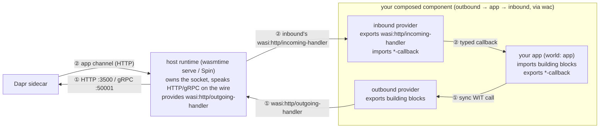
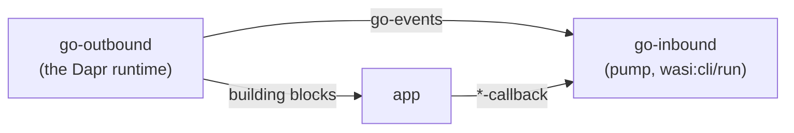

# dapr-wasm-components

[Dapr](https://dapr.io) building blocks for [WebAssembly components](https://component-model.bytecodealliance.org/), as pure-wasm modules:

- **`dapr-wasm-components-interfaces`** — the [WIT](https://github.com/WebAssembly/component-model/blob/main/design/mvp/WIT.md) package `dapr-wasm-components:interfaces` (`components/wit/`): typed, **synchronous** interfaces for every Dapr building block (the *outbound* direction, app → Dapr) and a set of `*-callback` interfaces (the *inbound* direction, Dapr → app), including the experimental/alpha building blocks.
- **Six provider components** (`components/`) — one per direction × family, so your app never touches the wire either way:
  - **`-wasi-http-outbound`** / **`-wasi-http-inbound`** — the [HTTP API](https://docs.dapr.io/reference/api/) over `wasi:http`. Portable: any WASI 0.2 runtime with `wasi:http` (wasmtime, wasmCloud, Spin, …). The inbound one exports `wasi:http/incoming-handler` and dispatches the app channel to the typed callbacks.
  - **`-wasi-grpc-outbound`** / **`-wasi-grpc-inbound`** — the [gRPC API](https://docs.dapr.io/developing-applications/local-development/grpc-integration/) (tonic + vendored Dapr protos). Typed protobuf instead of JSON — values roundtrip **byte-exact**. Needs a host that sends cleartext HTTP/2: [Spin](https://spinframework.dev) ≥ 3.4 (tested) or wasmCloud v2 (not tested yet) — see [below](#the-wasi-grpc-provider-spin-only). The inbound one serves Dapr's `AppCallback` gRPC service.
  - **`-go-outbound`** / **`-go-inbound`** — **Dapr itself** ([`github.com/dapr/dapr`](https://github.com/dapr/dapr), the code daprd runs) embedded in the component: **no sidecar, no RPC** between the app and Dapr. The outbound one is the runtime; the inbound one is a small pump that delivers the runtime's events to the app's callbacks. They come as a pair — see [below](#the-go-family-dapr-embedded-no-sidecar).
- **`dapr-app`** — the app-side SDK (`app-sdk/`): implement the `DaprApp` trait (every callback method has a default, so you override only what you use) and call Dapr through re-exported typed interfaces. Your application never touches HTTP or gRPC in **either** direction — the providers do.

Write your app against the interfaces, [compose](#composing) it with an outbound + an inbound provider (`wac`), and run it next to a Dapr sidecar — or, with the go family, on its own. The single diagram in [Two directions](#two-directions-calling-dapr-vs-being-called-by-dapr--both-typed) below shows the whole picture.

## Interfaces (`dapr-wasm-components:interfaces@0.7.3`)

**Outbound** — interfaces your app *imports* to call Dapr:

| Interface | Building block | Dapr API status |
|---|---|---|
| `state-read` | State, read side: get, get-bulk, **query** | stable (query: alpha) |
| `state` | State, write side: save, delete, **transactions** | stable |
| `pubsub` | Pub/sub: publish, **bulk publish** | stable |
| `bindings` | Output bindings | stable |
| `secrets-read` | Secrets: get one named secret | stable |
| `secrets` | Secrets: get-bulk (enumerate the whole store — the wider authority) | stable |
| `configuration-read` | Configuration: get | stable |
| `configuration` | Configuration: **subscribe**, returning a `subscription` resource (drop it to unsubscribe) | stable |
| `invocation` | Service invocation with full HTTP semantics (verb, headers, status passthrough) | stable |
| `lock` | Distributed lock: try-lock, unlock | alpha |
| `workflow-read` | Workflow management, read side: get a **typed** `workflow-instance` (name, `runtime-status` enum, input, output, failure details) | HTTP: `/v1.0`, deprecated but served; gRPC: `*WorkflowBeta1`, not deprecated |
| `workflow` | Workflow management, control side: start, terminate, raise-event, pause, resume, purge (always the built-in `dapr` workflow component) | same as `workflow-read` |
| `jobs-read` | Jobs/scheduler: get | stable since 1.16 |
| `jobs` | Jobs/scheduler: schedule (incl. failure policy), delete | stable since 1.16 |
| `crypto` | Cryptography: encrypt, decrypt (one-shot), and **streaming** `encryptor` / `decryptor` / `crypto-output` resources (write chunks, finish, read chunks) | alpha |
| `conversation` | Conversation (LLM): converse | alpha2 |
| `actors` | Actors (client side): invoke, state, transactions, reminders, timers | stable |
| `runtime` | Sidecar metadata, labels, health checks | stable |

**Inbound** — `*-callback` interfaces your app *exports* to be called by Dapr (names mirror Dapr's `AppCallback`):

| Interface | Delivered flow | Functions |
|---|---|---|
| `invocation-callback` | Service-invocation requests | `on-invoke` |
| `pubsub-callback` | Topic subscriptions (optional CEL routing rules: `routes { rules: [{match, path}], default }`; optional **bulk subscribe**) + deliveries (single or batched; `path` = the matched route) | `list-topic-subscriptions`, `on-topic-event`, `on-bulk-topic-event` |
| `bindings-callback` | Input bindings + deliveries | `list-input-bindings`, `on-binding-event` |
| `jobs-callback` | Job triggers | `on-job-event` |
| `actors-callback` | Actor hosting (HTTP app channel or go family; not over gRPC `AppCallback`) | `config`, `on-invoke`, `on-timer`, `on-reminder`, `deactivate` |
| `configuration-callback` | Configuration update pushes | `on-configuration-event` |
| `health-callback` | App health checks | `health-check` |

Diagrams of all worlds, interfaces, type dependencies and resource lifecycles: [components/wit/INTERFACES.md](components/wit/INTERFACES.md).

Worlds: **`app`** (an application — imports the building blocks, exports the callbacks), **`outbound`** (a provider that exports the building blocks) and **`inbound`** (a provider that imports the callbacks). The two provider directions are *separate components* so the composition graph stays acyclic — see below.

### The import list is the authority manifest

Blocks with a read-only subset are split in two: `<x>-read` (the reads, plus the types both halves share) and `<x>` (the rest). The `app` world imports both halves, but `wit-component` keeps **only the functions an app actually calls**. So a built component's imports say what it may do, and a deployer can check that with `wasm-tools component wit app.wasm` before composing it. For example, an app that only reads state imports `state-read` with just `get`, and no `state` at all (the `state-reader` fixture in `e2e/apps/` is checked like this by `e2e/tests/authority.rs`):

```wit
import dapr-wasm-components:interfaces/state-read@0.7.3;   // get only
import dapr-wasm-components:interfaces/configuration-read@0.7.3;   // types only
```

One caveat: an interface can also appear **with types only**. Every app exports all the callbacks, and `bindings-callback` uses `state-read.{state-item}` and `configuration-callback` uses `configuration-read.{configuration-item}`, so every app imports those two interfaces. Such an import has no functions, so it gives no authority.

### Error model

There is **no shared, all-encompassing `error` type**. Each operation returns
`result<…, E>` only for the failures it can actually produce, sorted by *who
acts on them*:

- **The success type is the 100%-happy path only.** An expected failure is
  still an error, never an `option` in the success slot: `state.get` →
  `result<get-state-response, get-error>` with a `key-not-found` case (not
  `result<option<…>, …>`).
- **Recoverable failures** are per-interface/per-function `variant`s — setup/config
  like `store-not-found`/`permission-denied`, plus operation-specific
  rejections (`state.save` → `write-error` with `etag-mismatch`; `lock.try-lock`
  → `try-lock-error` with `not-acquired`). Function errors embed the
  building-block error as a fallback case.
  The `string` in a setup case (`store-not-found(string)`, …) is the
  sidecar's human-readable message, the same on the HTTP and gRPC providers.
  Log it; don't parse it — the component name is the one you passed in.
- **Unrecoverable failures** (sidecar unreachable/not ready, an internal sidecar
  error, a timeout, an I/O fault) are **not in any type** — the provider **traps**
  (the component-model equivalent of a Rust `panic!`). Use Dapr resiliency
  policies, not per-call handling, for retries/circuit-breaking.

Inbound callbacks report a graceful handling failure with `types.app-error`
(a message); trapping from a callback also marks failure.

## Two directions: calling Dapr vs. being called by Dapr — both typed

A Dapr application communicates with its sidecar in two directions, and **the providers shield your app from the wire on both**. Your app is pure typed domain logic — it only implements WIT and never opens a socket.

- **Outbound — your app calls Dapr** (state, pub/sub, secrets, service invocation, …). Your app makes a synchronous WIT call on an imported building-block interface; the composed-in **outbound** provider turns it into a sidecar request (over the host's `wasi:http/outgoing-handler`) and blocks until the reply.
- **Inbound — Dapr calls your app** (service invocation, pub/sub deliveries, input bindings, job triggers, actor activations, configuration updates, health). The sidecar hits the *application channel*; the **inbound** provider owns `wasi:http/incoming-handler`, parses each request, and dispatches it as a typed call on the matching `*-callback` interface your app exports.

Why two provider components per transport? A single provider that both *exported* the building blocks and *imported* the callbacks would form an instantiation **cycle** with the app (the app imports the building blocks; the provider imports the callbacks) — which the component model forbids. Splitting outbound from inbound makes the graph acyclic: **`outbound → app → inbound`**.

The two directions are independent, so you mix and match: the portable `wasi-http` **inbound** provider serves the HTTP app channel on any runtime (even behind a `wasi-grpc`-outbound app), while the `wasi-grpc` **inbound** provider serves Dapr's `AppCallback` gRPC service (`--app-protocol grpc`) on a Spin host that accepts inbound h2c.



## Using the published modules

All modules are published to this repository's OCI registry — tag `latest` tracks `main`, semver tags come from GitHub releases:

```sh
ORG=ghcr.io/sideeffffect
wkg oci pull $ORG/dapr-wasm-components-interfaces:latest        -o interface.wasm
wkg oci pull $ORG/dapr-wasm-components-wasi-http-outbound:latest -o http-outbound.wasm
wkg oci pull $ORG/dapr-wasm-components-wasi-http-inbound:latest  -o http-inbound.wasm
# and likewise -wasi-grpc-outbound / -wasi-grpc-inbound and -go-outbound / -go-inbound

wasm-tools component wit interface.wasm    # view the interfaces as WIT text
```

### Depending on the WIT package with `wkg`

Releases also publish the WIT package under wkg's own naming scheme
(`ghcr.io/sideeffffect/dapr-wasm-components/interfaces:<version>`), so you can declare it as a normal WIT
dependency. Import it from your world:

```wit
package my:app;

world app {
  include dapr-wasm-components:interfaces/app@0.7.3;
}
```

then copy [`wkg-config.toml`](wkg-config.toml) (or merge its `[namespace_registries]` table into your wkg config) and
fetch:

```sh
wkg wit fetch --config wkg-config.toml   # writes wit/deps/ and wkg.lock — commit the lock file
```

## Writing an app (Rust)

Depend on the `dapr-app` SDK, implement the `DaprApp` trait (overriding only the callbacks you use), and export it. Call Dapr through the re-exported interfaces under `dapr_app::dapr`.

```toml
[dependencies]
dapr-app = { git = "https://github.com/sideeffffect/dapr-wasm-components" }
```

```rust
use dapr_app::{callback::pubsub_callback as ps, dapr::state, DaprApp};

struct App;

impl DaprApp for App {
    // Outbound-only apps override nothing. This one also handles a topic:
    fn list_topic_subscriptions() -> Vec<ps::TopicSubscription> {
        vec![
            ps::TopicSubscription::new("pubsub", "orders"),
            // Optional CEL routing rules: daprd picks the route, the app sees
            // it in `event.path` ("/widgets" or "/products").
            ps::TopicSubscription::new("pubsub", "inventory")
                .with_rule(r#"event.type == "widget""#, "/widgets")
                .with_default_route("/products"),
            // Bulk subscribe: batches of up to 100 events. The default
            // `on_bulk_topic_event` calls `on_topic_event` once per entry;
            // override it to handle the whole batch.
            ps::TopicSubscription::new("pubsub", "audit").with_bulk_subscribe(Some(100), None),
        ]
    }
    fn on_topic_event(event: ps::TopicEvent) -> ps::TopicEventResponse {
        // `event.data` is the domain payload; the envelope is already parsed.
        state::save("statestore", &[state::StateItem {
            key: "last-order".into(), value: event.data,
            etag: None, metadata: vec![], options: None,
        }], &[]).unwrap();
        ps::TopicEventResponse::Success
    }
}

dapr_app::export_app!(App);
```

See `e2e/apps/kv-demo/` for an outbound-only command and `e2e/apps/microservice/` for an inbound reactor.

### Composing

A composed component is `outbound → app → inbound` (acyclic — see [Two directions](#two-directions-calling-dapr-vs-being-called-by-dapr--both-typed)). Plain `wac plug` can't express it (it would re-export the app's callbacks). The repo ships a [`compose.sh`](compose.sh) wrapper that makes it a one-liner — it resolves the providers (a local `components/target/` release build when present, otherwise an OCI pull with `wkg`) and runs `wac` for you. The two directions are independent, so the transports are picked separately (e.g. gRPC out, HTTP in is valid):

```sh
./compose.sh my_app.wasm                       # http out + http in -> composed.wasm
./compose.sh my_app.wasm --out grpc --in http  # mixed transports
./compose.sh my_app.wasm -o server.wasm --tag 0.7.3   # explicit output + OCI tag

dapr run --app-id my-app -- wasmtime serve -S cli composed.wasm   # reactor (app channel)
# outbound-only command apps: `wac plug app.wasm --plug http-outbound.wasm` + `wasmtime run -S http`
```

Under the hood it invokes the repo's [`compose.wac`](compose.wac) with [`wac`](https://github.com/bytecodealliance/wac); to drive `wac` yourself (or in CI without the wrapper):

```sh
wac compose \
  --dep dapr:app=my_app.wasm \
  --dep dapr:outbound=http-outbound.wasm \
  --dep dapr:inbound=http-inbound.wasm \
  compose.wac -o composed.wasm
```

The outbound provider resolves the sidecar like other Dapr SDKs: `DAPR_HTTP_ENDPOINT`, then `http://127.0.0.1:$DAPR_HTTP_PORT`, then `http://127.0.0.1:3500`; `DAPR_API_TOKEN` is attached as the `dapr-api-token` header when set.

## The wasi-grpc provider (Spin only)

`dapr-wasm-components-wasi-grpc-outbound` exports the identical building blocks — apps don't change, they just compose a different provider — but implements them with a [tonic](https://github.com/hyperium/tonic) client (no `transport` feature) over a small `wstd` `wasi:http` transport, driven to completion inside each sync export by `wstd`'s `block_on` — the same stack as `wasi-http-outbound`. HTTP/2 is the host's job: Spin (h2c for the one authority in `SPIN_OUTBOUND_H2C_PRIOR_KNOWLEDGE`) and wasmCloud v2 (every `application/grpc` request) provide it. The Dapr v1.18 protos are vendored and the generated client is checked in — no protoc needed to build. The matching `dapr-wasm-components-wasi-grpc-inbound` serves Dapr's `AppCallback` gRPC service (`--app-protocol grpc`) by hand-rolling the gRPC server framing over `wasi:http/incoming-handler` (reusing the same vendored protobuf messages) — it needs a Spin host that accepts **inbound** h2c.

Why bother: protobuf carries values as raw bytes, so binary state values, binding payloads and pub/sub events roundtrip **byte-exact** (the HTTP provider's JSON envelope can't do that), and errors map 1:1 from `grpc-status` codes.

The catch: gRPC requires HTTP/2 end-to-end, `wasi:http` 0.2 leaves the HTTP version to the host, and today only **Spin ≥ 3.4** speaks outbound cleartext HTTP/2 (wasmtime's `wasi:http` is HTTP/1.1-only — there the component instantiates, but calls fail with `unavailable`). Two things must line up, byte-for-byte, on the **same authority string**:

```sh
# on the Spin host process (NOT spin up --env): enables h2c to this one authority
export SPIN_OUTBOUND_H2C_PRIOR_KNOWLEDGE=127.0.0.1:50001
```

```toml
# spin.toml: let the component reach daprd, and point it at the gRPC endpoint
[component.my-app]
source = "composed.wasm"
allowed_outbound_hosts = ["http://127.0.0.1:50001"]
environment = { DAPR_GRPC_ENDPOINT = "http://127.0.0.1:50001" }
```

Endpoint resolution mirrors the SDKs: `DAPR_GRPC_ENDPOINT`, then `http://127.0.0.1:$DAPR_GRPC_PORT`, then `http://127.0.0.1:50001`; `DAPR_API_TOKEN` becomes `dapr-api-token` gRPC metadata. See `e2e/apps/microservice/` and `e2e/tests/spin.rs` for a complete working setup.

Divergences from the wasi-http provider (inherent to the gRPC API): service invocation cannot pass through the target app's exact status code (success is always `200`, non-2xx surfaces as `error`); a missing state/actor key is indistinguishable from a stored empty value; sidecar health checks use `GetMetadata` (daprd has no gRPC health service); crypto's streaming RPCs are driven as one RPC per operation, so the streaming `encryptor`/`decryptor` resources **buffer** the whole input and output in provider memory (the payload goes out as 1 MiB `seq`-numbered messages, so it is not limited by daprd's 4Mi per-message cap).

## The go family (Dapr embedded, no sidecar)

`dapr-wasm-components-go-outbound` **is** Dapr: the runtime daprd runs (`github.com/dapr/dapr` v1.18, pinned in `go.mod`), compiled to wasm with big Go (≥ 1.27.1) and [`componentize-go`](https://github.com/bytecodealliance/componentize-go). Every building block is a plain Go call on the runtime's in-process API object — no HTTP or gRPC between the app and Dapr. Apps don't change: they target the same `app` world.



Inbound is pulled, not pushed: `go-inbound` (about 300 lines of Rust, no Dapr state) loops `next-event` → the app's matching callback → `complete-event`. That keeps the graph acyclic and never re-enters an instance, so a callback may call any building block. The composed app holds **one** Go runtime and **one** Dapr runtime. The pump is not written in Go on purpose: it would add a second Go runtime.

Compose and run — the program arguments are daprd's own flags, parsed by daprd's own parser:

```sh
./compose.sh my_app.wasm --out go -o composed.wasm
wasmtime run -S inherit-network -S tcp -S allow-ip-name-lookup \
  --dir ./resources::/resources --env DAPR_HOST_IP=127.0.0.1 \
  composed.wasm --app-id my-app --resources-path /resources --dapr-http-port 3500
```

How it works, in short (details in [the design spec](docs/superpowers/specs/2026-10-12-go-family-design.md) and the wiki):

- **Network.** Go's `wasip1` port has only an in-process fake network. `go-outbound` is built with a `go build -overlay` that patches std `net` to use `wasi:sockets` (TCP, listen/accept, DNS) — so Redis, Kafka, Postgres, Consul, placement, scheduler and peer runtimes are reachable. Socket waits are cooperative (non-blocking `wasi:io` plus a short sleep), because Go on wasm runs every goroutine on one thread.
- **App channel.** The runtime reaches the app with plain Go calls — no HTTP, no app protocol on the wire. It runs in gRPC app-protocol mode with two in-process objects plugged in: an `AppCallback` "connection" that hands each typed protobuf request (pub/sub, bulk pub/sub, input bindings, subscription lists) straight to a handler, and an app channel for invocation, jobs, actors and health. Each handler queues a typed event for the pump.
- **Components.** `scripts/gen-components.py` selects daprd's stable component set minus what does not build for wasip1 (sqlite, Pulsar, Dubbo, some Azure SDKs), plus crypto, Consul, the Redis lock and the conversation components.
- Values are raw bytes — binary state roundtrips byte-exact.

## Repository layout

`components/` holds the published modules (the interface package + six provider components); the app SDK lives in `app-sdk/`; everything that exists only to test them lives under `e2e/`.

| Path | What |
|---|---|
| `components/wit/` | The `dapr-wasm-components:interfaces` WIT package (worlds `app`, `outbound`, `inbound`) |
| `components/wasi-http-outbound/` | wasi:http **outbound** provider — the building blocks over the Dapr HTTP API (portable) |
| `components/wasi-http-inbound/` | wasi:http **inbound** provider — exports `wasi:http/incoming-handler`, dispatches the app channel to the typed callbacks (portable) |
| `components/wasi-grpc-outbound/` | wasi:grpc **outbound** provider — the building blocks over the Dapr gRPC API (Spin ≥ 3.4; vendored protos + checked-in tonic codegen) |
| `components/wasi-grpc-inbound/` | wasi:grpc **inbound** provider — serves Dapr's `AppCallback` gRPC service over `wasi:http/incoming-handler` (Spin h2c inbound), dispatching to the typed callbacks |
| `components/go-outbound/` | go **outbound** — the Dapr runtime embedded (Go module, built with `componentize-go`): every building block in-process + the private `go-events` queue (`wit/go.wit`); `scripts/build.sh` builds it |
| `components/go-inbound/` | go **inbound** — the Rust pump (`wasi:cli/run`) delivering the runtime's events to the app's callbacks |
| `app-sdk/dapr-app/` | The app-side `dapr-app` SDK (`DaprApp` trait + `export_app!`); wasm-only |
| `compose.wac` / `compose.sh` | The `outbound → app → inbound` composition graph, and a wrapper that resolves the providers and runs `wac` as a one-liner |
| `e2e/` | Test harness: mock-sidecar tests, wac composition, and the real-Dapr E2Es (shared scenario in `tests/common/`) |
| `e2e/apps/` | Demo/fixture app components the E2Es compose and drive (their own wasm-only workspace) |
| `e2e/apps/kv-demo/` | Outbound-only example (`wasi:cli` command), used by the mock composition test |
| `e2e/apps/microservice/` | The real-Dapr E2E app (a typed reactor): run as two instances (publisher + consumer) by **both** suites to exercise state, pub/sub, service invocation and streaming crypto |
| `e2e/apps/state-reader/` | A read-only app (calls only `state-read.get`); `e2e/tests/authority.rs` checks that its imports show exactly that |
| `wiki/`, `raw/` | LLM-maintained knowledge base with the research behind the design |

## Development

There are four Cargo workspaces: the native `e2e` harness (root), the published providers (`components/`, wasm-only), the app SDK (`app-sdk/`, wasm-only), and the demo apps (`e2e/apps/`, wasm-only).

```sh
rustup target add wasm32-wasip2

# format / build / lint each wasm workspace, plus the native harness
cargo fmt --all
cargo fmt --all --manifest-path components/Cargo.toml
cargo fmt --all --manifest-path app-sdk/Cargo.toml
cargo fmt --all --manifest-path e2e/apps/Cargo.toml
cargo build --release --target wasm32-wasip2 --manifest-path components/Cargo.toml
cargo build --release --target wasm32-wasip2 --manifest-path app-sdk/Cargo.toml
cargo build --release --target wasm32-wasip2 --manifest-path e2e/apps/Cargo.toml
cargo clippy --all-targets -- -D warnings
cargo clippy --target wasm32-wasip2 --manifest-path components/Cargo.toml -- -D warnings
cargo clippy --target wasm32-wasip2 --manifest-path app-sdk/Cargo.toml -- -D warnings
cargo clippy --target wasm32-wasip2 --manifest-path e2e/apps/Cargo.toml -- -D warnings
cargo test    # provider tests + composed kv-demo, against a mock sidecar

# go-outbound (Go >= 1.27.1 + componentize-go): format, vet, unit tests, build
(cd components/go-outbound && gofmt -l $(git ls-files '*.go'))
(cd components/go-outbound && go test ./internal/anyjson/ ./internal/streams/)
components/go-outbound/scripts/build.sh
```

`components/go-outbound/` keeps its generated code checked in: `scripts/gen-bindings.sh` (WIT bindings), `scripts/gen-components.py` (Dapr component registrations). Re-run them after changing the WIT or bumping `github.com/dapr/dapr`.

### Real-Dapr end-to-end test

Both real-Dapr suites run the **same scenario** (`e2e/tests/common/run_mirrored_scenario`) so they mirror each other and differ only in provider + runtime. The `microservice` app is run as two instances — a `publisher` and a `consumer` — each behind its own **actual `daprd` sidecar**; the scenario drives a state roundtrip + etag CAS + delete, a `local.file` secret read (incl. a missing secret → `secret-not-found`), service invocation (self and cross-app), and a cross-sidecar pub/sub publish→deliver→count loop. Pub/sub is Redis (cross-sidecar), name resolution is sqlite (deterministic in CI). All infrastructure — both `daprio/daprd` sidecars and Redis — is started by the test itself with [testcontainers](https://rust.testcontainers.org/).

`e2e/tests/dapr.rs` (**wasi-http** provider) serves the instances with `wasmtime serve`; you only need Docker and the `wasmtime` CLI:

```sh
cargo build --release --target wasm32-wasip2 --manifest-path components/Cargo.toml  # the provider
cargo build --release --target wasm32-wasip2 --manifest-path e2e/apps/Cargo.toml     # the microservice
cargo test --test dapr -- --ignored
```

`e2e/tests/spin.rs` (**wasi-grpc** outbound provider; the app channel still uses `wasi-http-inbound`) is the gRPC mirror: it serves the same two instances with the `spin` CLI (the only runtime with outbound h2c), and additionally asserts a *binary* byte-exact state roundtrip — something only the gRPC provider can do. Requires Docker and `spin` ≥ 3.4 (override with `SPIN_BIN`):

```sh
cargo build --release --target wasm32-wasip2 --manifest-path components/Cargo.toml  # the provider
cargo build --release --target wasm32-wasip2 --manifest-path e2e/apps/Cargo.toml     # the microservice
cargo test --test spin -- --ignored
```

`e2e/tests/go.rs` (**go** family) runs the same scenario with no sidecar at all: each instance is `go-outbound → microservice → go-inbound` under `wasmtime run`, configured with daprd flags, and the scenario reaches the apps through each embedded runtime's own Dapr HTTP API. Name resolution is Consul (a testcontainer; the sqlite resolver does not build for wasm). Requires Docker and `wasmtime`:

```sh
components/go-outbound/scripts/build.sh
cargo build --release --target wasm32-wasip2 --manifest-path components/Cargo.toml
cargo build --release --target wasm32-wasip2 --manifest-path e2e/apps/Cargo.toml
cargo test --test go -- --ignored
```

CI runs all three on every push to `main` and every pull request (the `dapr-e2e`, `spin-e2e` and `go-e2e` jobs).

## Status & limitations

Experimental. Tracked follow-up work lives in [ROADMAP.md](ROADMAP.md).

- The whole Dapr **outbound** HTTP API surface is covered, including alpha APIs (lock, crypto, state query, conversation) — alpha APIs can change with Dapr releases.
- Values in the HTTP state/bindings APIs are JSON: bytes that parse as JSON are sent as-is, anything else is sent as a JSON string (UTF-8 lossy). Store JSON if you need byte-exact roundtrips — **or use the wasi-grpc provider**, where values are raw protobuf bytes.
- **Streaming crypto** (`encryptor` / `decryptor` → `crypto-output`) is sync WIT resources, no WASI 0.3: write the input in chunks, `finish`, then read the output in chunks (write-all-then-read; interleaving is not supported). The `dapr-app` SDK wraps them as `std::io` types (`dapr_app::crypto_io`). What it saves depends on the provider and on daprd:
  - `wasi-http-outbound` streams both bodies over `wasi:http`, so neither the app nor the provider holds the whole payload. But daprd v1.18 buffers the whole output before it answers ([`io.ReadAll` in `pkg/api/http/crypto.go`](https://github.com/dapr/dapr/blob/v1.18.0/pkg/api/http/crypto.go)) and caps the HTTP input at `--max-body-size` (default 4Mi); a larger input makes daprd fail the call (a 5xx, so the provider traps). The streaming resources first check the component with `GET /v1.0/metadata`.
  - `wasi-grpc-outbound` buffers input and output in provider memory (see the gRPC section). daprd's gRPC side streams for real and has no total-size cap.
  - daprd reports a missing key (`ERR_CRYPTO_KEY`) and a failed decryption (`ERR_CRYPTO`) as HTTP 500 / gRPC `Internal`, so both providers trap on these instead of returning `key-not-found` / `malformed-ciphertext`.
- **Jobs uses the jobs API's `alpha1` surface** — `/v1.0-alpha1/jobs/…` over HTTP, the `*JobAlpha1` RPCs over gRPC — because daprd ≤ 1.17 serves nothing else (checked for 1.14 – 1.17; 1.18 adds `/v1.0` and the stable RPCs and keeps `alpha1` as a deprecated alias).
- **`actors.register-timer` on an actor type the app does not host** returns `permission-denied` (daprd's message), like `register-reminder` does. daprd reports the timer case as a generic HTTP 500 / gRPC `Internal` `ERR_ACTOR_TIMER_CREATE`, so the providers recognise it by its `actor type not registered` message; any other `ERR_ACTOR_TIMER_CREATE` still traps.
- Conversation models the full alpha2 surface: content-part messages with role wrappers, tool definitions and tool calls, structured-output schema, prompt-cache retention, and per-token usage in the response.
- **Inbound (Dapr → app) is typed via the `*-callback` interfaces**, implemented by the **`wasi-http-inbound`** provider (full HTTP app-channel router), the go family's `go-inbound` pump and the `dapr-app` SDK; all three real-Dapr E2Es exercise it (pub/sub delivery + service invocation, self and cross-app). Pub/sub supports CEL routing rules (the matched rule path arrives in `topic-event.path`; verified through real daprd), and bulk subscribe (`topic-subscription.bulk-subscribe` + `on-bulk-topic-event`, with an SDK default that loops over `on-topic-event`; combinable with routing rules); all three real-Dapr E2Es deliver a routed topic and a bulk-subscribed topic; input bindings are delivered end to end in all three, but note that **daprd ignores the input-binding reply** over the HTTP app channel (over gRPC and in the go family it applies only `to`/`data`/`concurrency`) — do side effects with the outbound `state`/`bindings` interfaces instead; configuration-update delivery (`configuration-callback`) is wired in the router (`POST /configuration/<store>/<key>`) and covered by a composed in-process test.
- **Workflow deprecation affects only the HTTP provider.** `wasi-http-outbound` uses the `/v1.0` workflow HTTP API. Dapr documents it as deprecated in favour of the SDKs, but offers no non-deprecated HTTP replacement, and Dapr 1.19 still serves it. `wasi-grpc-outbound` uses the gRPC `*WorkflowBeta1` RPCs. In the vendored v1.18 protos these RPCs have no `deprecated` option (only the `*WorkflowAlpha1` set has it).
- **Actor hosting with gRPC outbound.** Dapr's `AppCallback` gRPC service has no actor methods, so actor hosting needs the HTTP app channel. To use gRPC outbound *and* host actors, compose `wasi-grpc-outbound` with `wasi-http-inbound` (`./compose.sh my_app.wasm --out grpc --in http`) and run daprd with `--app-protocol http`. Outbound calls go over gRPC; actor callbacks arrive over the HTTP app channel. The gRPC-native alternative, `SubscribeActorEventsAlpha1` (an app-initiated bidirectional stream, `actors.proto`), is not used: it needs a long-lived bidi stream that request-scoped wasm/Spin HTTP triggers cannot hold, and it is alpha.
- **Inbound transport is independent of outbound.** The portable `wasi-http-inbound` provider serves the HTTP app channel on any runtime (including behind a `wasi-grpc`-outbound app). The `wasi-grpc-inbound` provider serves Dapr's `AppCallback` gRPC service (`--app-protocol grpc`); it is verified working over Spin's inbound h2c with `grpcurl` (`ListTopicSubscriptions`, `HealthCheck`) but does not yet have an automated daprd `--app-protocol grpc` E2E. Actor *hosting* needs the HTTP app channel (or the go family), since Dapr's `AppCallback` has no actor methods.
- **go family limits.** The app is **one long-lived instance**, and it runs only inside a callback. So a delivery to the app cannot be served while a callback is running: **self-invocation** (`invocation.invoke` of the app's own id) fails fast with `app-unreachable`, and a call cycle that comes back to the same app (A → B → A) hangs unless a Dapr resiliency timeout is configured. Go goroutines run only while go-outbound is on the stack, so a long callback that never calls Dapr pauses Dapr's background work (subscribers, heartbeats). Dapr's `HotReload` feature is off (WASI has no file watching), mDNS name resolution cannot work (no UDP multicast — use Consul, Kubernetes or a static resolver), and `DAPR_HOST_IP` must be set when a name resolver registers the app. The component is large (about 260 MB: the Dapr runtime plus the component SDKs).
- The wasi-grpc (outbound) provider remains a proof of concept: it is tested only on Spin ≥ 3.4 (outbound h2c; its h2c allowlist holds a single authority) — wasmCloud v2 sends `application/grpc` over HTTP/2 and should work, but has no E2E yet. Most interfaces are compile-checked but only the E2E surface (state, invocation, pub/sub, metadata) is integration-tested.

## License

[Apache-2.0](LICENSE)
