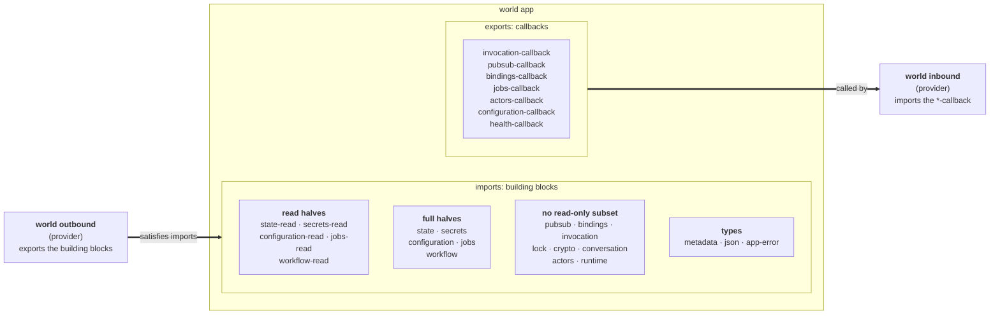
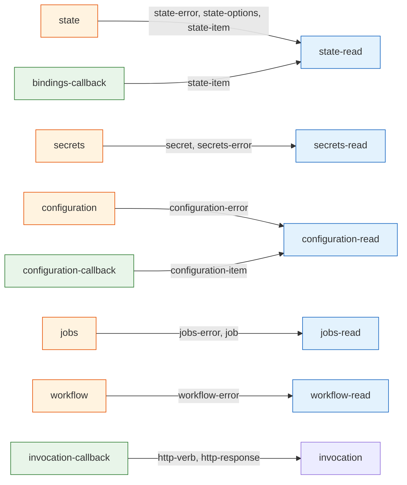
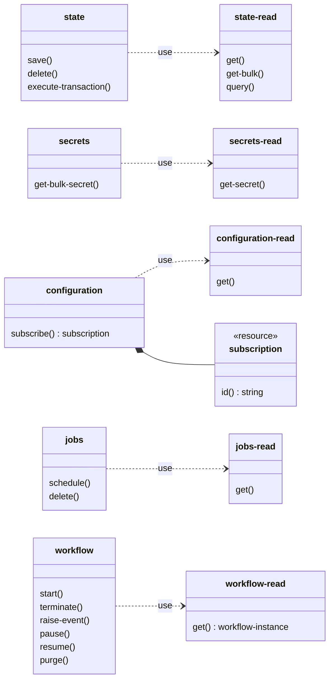
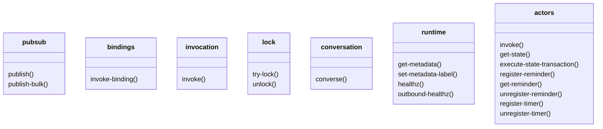
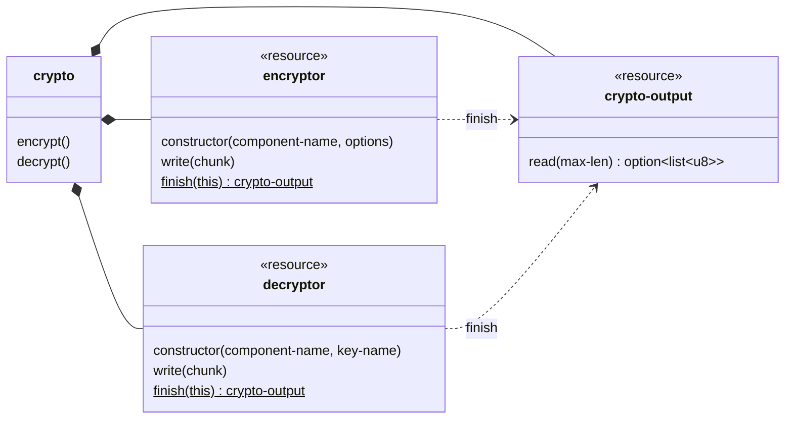
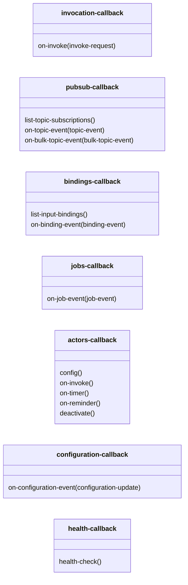
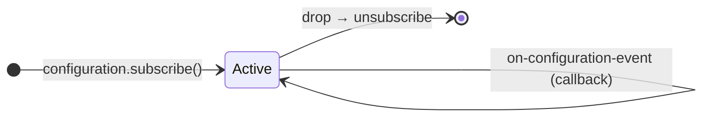
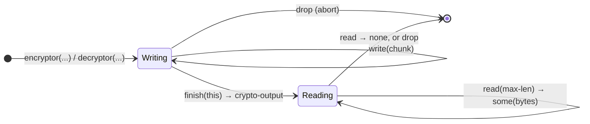

# Interfaces at a glance (`dapr-wasm-components:interfaces@0.7.1`)

Diagrams of the WIT package in this directory. The `.wit` files are the source of truth. The [README](../../README.md#interfaces-dapr-wasm-componentsinterfaces070) has the tables. Its [runtime diagram](../../README.md#two-directions-calling-dapr-vs-being-called-by-dapr--both-typed) shows how the composed component talks to the sidecar.

1. [Worlds](#1-worlds): who imports and who exports each interface.
2. [Type dependencies](#2-type-dependencies): the `use` graph, including the authority split.
3. [Outbound building blocks](#3-outbound-building-blocks): the functions and resources an app calls.
4. [Inbound callbacks](#4-inbound-callbacks): the functions an app implements.
5. [Resource lifecycles](#5-resource-lifecycles): `configuration.subscription` and the streaming `crypto` resources.

## 1. Worlds

Three worlds. An app imports the building blocks and exports the callbacks. The `outbound` provider exports the building blocks. The `inbound` provider imports the callbacks. So the composition graph `outbound → app → inbound` has no cycle.

Each provider family has one component per world:

| World | Components |
|---|---|
| `outbound` | `wasi-http-outbound`, `wasi-grpc-outbound`, `go-outbound` |
| `app` | your app (with the `dapr-app` SDK), `e2e/apps/*` |
| `inbound` | `wasi-http-inbound`, `wasi-grpc-inbound`, `go-inbound` |

The `go` pair is a special case. `go-outbound` embeds the Dapr runtime itself, so there is no sidecar. `go-inbound` gets the deliveries from `go-outbound` through a private interface that is not part of this package, so the two must be used together. The `go-inbound` world (in `components/go-outbound/wit/go.wit`) includes the `inbound` world.

## 2. Type dependencies

Arrows point from the interface that has the `use` to the interface that owns the type. Edges to `types` are not shown. These interfaces use `types` (`metadata`, `json`, `app-error`): all of them except `crypto`, `lock`, `jobs`, `workflow-read` and `workflow`.

A `<x>-read` half owns the types that both halves share, so the full half `<x>` points to it. The import list of a component is its authority manifest: an app that only reads state imports no `state` function.

Legend: blue = read half, orange = full half, green = callback.

## 3. Outbound building blocks

The functions an app imports. Arguments and most return types are left out. Most functions return `result<…, E>`, where `E` is a per-function or per-interface error variant. Infrastructure failures (sidecar not reachable, timeout) trap; they are not error values. The `string` in a setup error case (`store-not-found`, `permission-denied`, …) is the sidecar's message, for logs only. See the README [error model](../../README.md#error-model).

`crypto` has one-shot functions and three streaming resources:

## 4. Inbound callbacks

The functions an app exports. The inbound provider calls them. Every export is mandatory, because the component model has no optional exports. The `dapr-app` SDK gives a default for each one, so an app overrides only what it uses.

Two kinds of callback:

- **Discovery** (`list-topic-subscriptions`, `list-input-bindings`, `actors-callback.config`): the sidecar asks at startup what the app wants.
- **Delivery** (all `on-*`, `deactivate`, `health-check`): the sidecar sends one event or request.

## 5. Resource lifecycles

### `configuration.subscription`

`subscribe` returns a `subscription`. Updates come in through `configuration-callback.on-configuration-event`. Drop the resource to unsubscribe.

### Streaming `crypto`

The `encryptor` and `decryptor` resources take the input chunk by chunk. `finish` is static: it consumes the resource and returns a `crypto-output`. Read the result chunk by chunk until `read` returns `none`.

