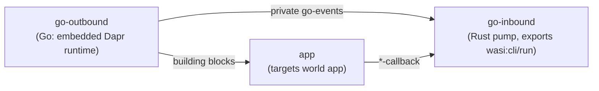
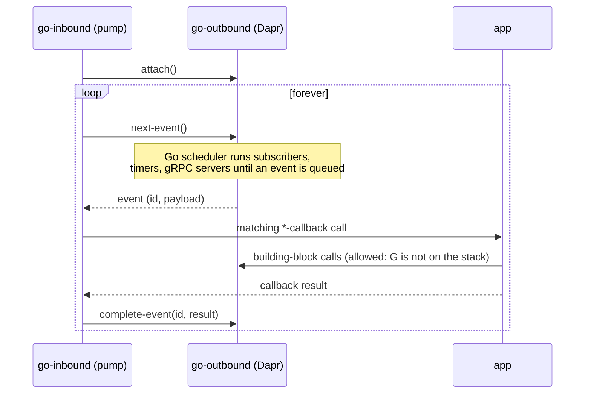

# Go provider family (`dapr-wasm-components-go-outbound` / `-go-inbound`) — design

Status: approved in brainstorming 2026-10-12, pending spec review.

## Goal

A third provider family that implements the `dapr-wasm-components:interfaces`
WIT package **with Dapr itself embedded in the component** — no daprd sidecar,
no HTTP/gRPC hop between the app and Dapr. The app is unchanged: it still
targets the `app` world and uses the `dapr-app` SDK.

Success = the shared real-Dapr scenario (`e2e/tests/common::run_mirrored_scenario`)
passes with the go family, with every WIT building block implemented (none
traps as "unsupported").

## Feasibility evidence (probe, 2026-10-12, throwaway in `/tmp/daprprobe`)

- Go 1.27.2 builds `github.com/dapr/dapr/cmd/daprd` for `GOOS=wasip1` (138 MB);
  it starts under wasmtime 45.
- `componentize-go` v0.5.0 (big Go ≥ 1.27.1, not TinyGo) builds a component
  that exports a custom WIT interface backed by components-contrib's
  in-memory state store (6.3 MB); `wasmtime run --invoke 'get("k")'` → `ok(none)`.
- Blocker found: on `wasip1`, Go's `net` package is an in-process fake
  (`net/net_fake.go`): `net.Dial` to a real listening port returns
  "connection refused". Solved by the sockets overlay below.

## Decisions

| Topic | Decision | Why |
|---|---|---|
| Toolchain | Big Go ≥ 1.27.1 + `componentize-go` | TinyGo cannot build Dapr (reflection, deps). |
| Embedding depth | Dapr runtime internals: `pkg/runtime` (component loader, compstore, resiliency, app channel, internal gRPC server) and `pkg/api/universal` | Keeps Dapr semantics (key prefixes, resiliency, scopes, actors, workflows) instead of re-implementing them over components-contrib. |
| Upstream pin | `go.mod` `require github.com/dapr/dapr v1.18.x` (same minor as the vendored protos of wasi-grpc), with dapr's own `replace` lines copied | User choice; no git submodule. |
| Networking | `go build -overlay` replaces `net/net_fake.go` (and the wasip1 resolver) with a `wasi:sockets@0.2` implementation | Real TCP to Redis, Kafka, Postgres, placement, scheduler, peer sidecars. |
| Socket waits | Cooperative polling: non-blocking `wasi:io` read/write; when not ready, the goroutine sleeps with backoff 1 → 10 ms | Go on wasm is single-threaded; a blocking `poll` would freeze every goroutine. No runtime patch. |
| Config | Same as daprd standalone: resource YAMLs in a preopened dir (`DAPR_RESOURCES_PATH`, default `/resources`), optional `DAPR_CONFIG` file, `APP_ID` / `DAPR_NAMESPACE` / ports from `wasi:cli/environment` | The same files work with a real daprd. |
| Scope | Every WIT building block, including actors, workflow, jobs, invocation | User choice. |
| Inbound model | Pull-based: one Dapr runtime in `go-outbound`; `go-inbound` is a Rust pump | See next section. |
| E2E | `e2e/tests/go.rs` runs the shared `run_mirrored_scenario` | Same coverage as `dapr.rs` / `spin.rs`. |

## Architecture: one runtime, pull-based inbound

The existing families split outbound and inbound so the graph
`outbound → app → inbound` stays acyclic. For the go family, the two halves
must share **one** Dapr runtime: actor timers, reminders and workflow state
live in the runtime that hosts the actors, and that runtime must also serve the
app's outbound calls. A single component that *imports* the callbacks would
form a cycle, and pushing a callback while the app then calls back into the
same instance re-enters it (the component model traps).

So inbound is inverted from push to pull:



- `go-outbound` exports the public `outbound` world **and** a private
  interface `dapr-wasm-components:go-events/events` (own WIT package in
  `components/go-outbound/wit/`, not part of the published interfaces package,
  so the interfaces version does not change).
- `go-inbound` imports `events` and the seven `*-callback` interfaces and
  exports `wasi:cli/run`. Its loop:



- No instance is ever re-entered: when the pump calls the app, `go-outbound`
  is not on the stack.
- **The composed app contains exactly one Go runtime and one Dapr runtime**
  (inside `go-outbound`). `go-inbound` holds no Dapr state and must not be
  written in Go — a Go pump would add a second Go runtime.

### `go-events` WIT (private)

```wit
package dapr-wasm-components:go-events@0.1.0;

interface events {
  use dapr-wasm-components:interfaces/pubsub-callback@0.6.0.{...};
  // ... (types from each *-callback interface)

  variant event {
    invoke(invoke-request),
    topic(topic-event),
    topic-bulk(bulk-topic-event),
    binding(binding-event),
    job(job-event),
    actor-invoke(actor-invoke-request),
    actor-timer(actor-timer-event),
    actor-reminder(actor-reminder-event),
    actor-deactivate(actor-ref),
    configuration-update(configuration-update),
    health-check,
    // app-discovery queries the runtime makes at start:
    list-subscriptions,
    list-input-bindings,
    actor-config,
  }

  variant event-result { /* one case per event, carrying the callback's return value */ }

  /// Enables the app channel. Must be the first call; without it the runtime
  /// runs like daprd without --app-port (outbound only).
  attach: func();
  /// Blocks (running the Go scheduler) until an event is queued.
  next-event: func() -> tuple<u64, event>;
  complete-event: func(id: u64, result: event-result);
}
```

Exact cases mirror the callback signatures one to one; they are fixed while
implementing, against `components/wit/*-callback.wit`.

## Components

### `components/go-outbound/` (Go module, built with `componentize-go`)

- `runtime/` — boots `pkg/runtime` lazily on the first export call: standalone
  mode, resources path, internal gRPC server and public Dapr HTTP/gRPC API
  servers on loopback ports from env (the public API is used by the E2E to
  drive the apps, like a daprd), metrics off.
- `appchannel/` — implements Dapr's `channel.AppChannel` (and the actor /
  subscription / binding / job app-callback hooks) by queuing an `event` and
  waiting for `complete-event`.
- `export_*` packages — one per WIT interface; map WIT ↔ Dapr's
  `runtimev1pb` messages and call `universal.Universal` (or the runtime's
  pubsub / bindings / direct-messaging / actors / workflow APIs where
  `Universal` has no method). The wasi-grpc provider already maps WIT ↔ the
  same protos; reuse its field mapping as the reference.
- `netoverlay/` — overlay files for `net` (TCP dial, listen/accept, DNS via
  `wasi:sockets/ip-name-lookup`; UDP returns "not supported") using
  `//go:wasmimport` of `wasi:sockets` / `wasi:io` functions; the world
  includes `wasi:sockets/*` so `wit-component` wires them.
- Error contract (same as the other providers): recoverable failures map to
  the typed WIT errors; infrastructure failures `panic` (= trap).

### `components/go-inbound/` (Rust crate in the `components/` workspace)

About 300 lines: `wit_bindgen` world importing `go-events/events` and the
callbacks, exporting `wasi:cli/run`; the loop above. Any callback trap is a trap
of the pump (whole composition stops), same as today's inbound providers.

### Composition / running

`compose-go.wac`: `go-outbound` → `app` → `go-inbound`, with `go-inbound`
also wired to `go-outbound`'s `events`. Run:

```sh
wasmtime run -S inherit-network -S tcp -S allow-ip-name-lookup \
  --dir ./resources::/resources --env APP_ID=publisher composed.wasm
```

## Known limitations (documented in README + wiki)

- While an app callback runs **without** calling Dapr, Go goroutines are
  paused (single thread): placement/scheduler heartbeats can lag during long
  handlers.
- Socket wait latency: up to ~10 ms per wait (cooperative polling).
- No UDP: mDNS name resolution does not work; use sqlite / consul / k8s DNS.
- Component size: likely 60–140 MB (Dapr + all components-contrib
  components). Mitigation: build with a curated component set (Go build
  tags), documented.
- The pump owns `wasi:cli/run`, so the app must be a library component (the
  `microservice` app is); command apps like `kv-demo` use `go-outbound`
  alone (no inbound).

## Testing

- Go unit tests for WIT ↔ proto mapping and the event queue (`go test`,
  native, no wasm needed).
- Overlay smoke: a tiny Go component dials a local TCP echo server
  (E2E `e2e/tests/go.rs`, first test).
- Mirrored scenario `e2e/tests/go.rs` (ignored by default, needs Docker +
  wasmtime): two compositions (`publisher`, `consumer`) under
  `wasmtime run`, Redis + placement + scheduler from testcontainers, sqlite
  name resolution on a shared host dir. The test drives the apps through
  each embedded runtime's public HTTP API (loopback port), like `dapr.rs`
  drives daprd. Binary state is byte-exact (in-process, no JSON envelope).
- CI: new job installs Go 1.27 + `componentize-go`, builds both components,
  runs Go tests, and `wkg oci push`es the two new packages.

## Risks (ordered; each is checked first in the implementation plan)

1. `wit-component` must accept hand-written `//go:wasmimport` of
   `wasi:sockets` functions from an overlaid std file. Fallback: put the
   imports in a normal package and have the overlay call it through a
   `go:linkname` hook.
2. `pkg/runtime` may assume real OS features (signals, file watchers,
   `os/exec`) at start. Fallback: assemble the needed pieces (compstore,
   processor, universal, actors) by hand instead of `runtime.Run`.
3. sqlite name resolution needs file locking across two wasmtime processes
   (`modernc.org/sqlite` on wasip1). Fallback: give each app a static
   `nameresolution` via a local `hosts`-style component or consul.
4. Component size / build time in CI.

## Out of scope

- Spin support for the go family (Spin has no general `wasi:sockets` TCP
  listen).
- Kubernetes mode, mTLS / Sentry, the Dapr operator.
