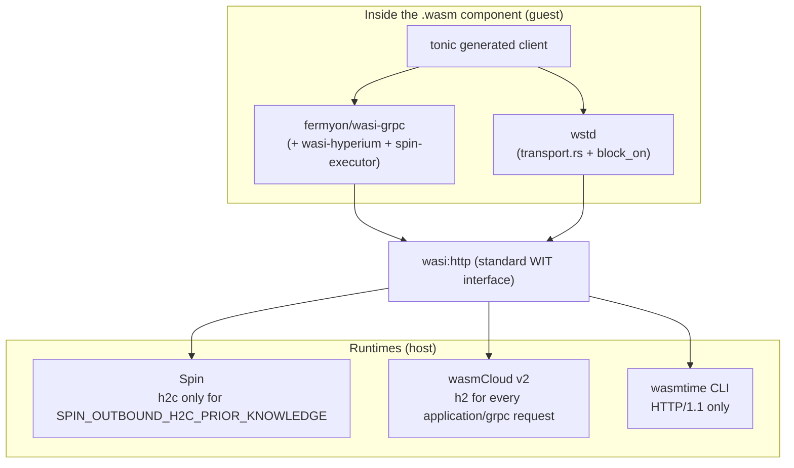

# Talking to Dapr over gRPC from a Wasm component

> Sources: Dapr proto, tonic/h2/wstd docs, Fermyon `wasi-grpc`, wasmtime wasi-http docs; 2026-06-12
> Raw: [dapr-grpc-from-wasm-research-2026-06](../../raw/dapr/dapr-grpc-from-wasm-research-2026-06.md)

## Question

Could there be a **pure-wasm** `dapr-wasm-components-*-grpc` sibling to
[`dapr-wasm-components-wasi-http`](dapr-wasm-components-architecture.md) — a second
implementation of the same `dapr-wasm-components:interfaces` WIT that talks to the Dapr
sidecar's **gRPC** API (`:50001`) instead of its HTTP API (`:3500`), with no native host?

**Verdict:** feasible and worthwhile, but materially harder than the wasi-http sibling. The
hard part is not gRPC or protobuf — it is obtaining an **HTTP/2 transport that runs inside a
wasm component**. (Confidence 0.85.)

**Outcome (2026-06-12):** the Spin-only path was *built* as a deliberate proof of concept —
`dapr-wasm-components-wasi-grpc` (`components/wasi-grpc/`) implements all 13 interfaces on
Fermyon's `wasi-grpc` crate and passes a real-daprd E2E under Spin 4.0 (state byte-exact +
CAS, invocation, pub/sub). The Spin coupling documented below was accepted knowingly; the
`wasi:sockets`+`h2` option remains the portable follow-up. Implementation decisions and traps
live in [dapr-wasm-components Architecture](dapr-wasm-components-architecture.md).
(Since the 2026-06-13 restructure and outbound/inbound split, this provider is
`dapr-wasm-components-wasi-grpc-outbound` in `components/wasi-grpc-outbound/`. A
`wasi-grpc-inbound` provider now serves Dapr's `AppCallback` service over Spin inbound h2c.
CI runs the Spin E2E on Spin 4.2.2.)

## What Dapr's gRPC API requires

`DaprClient` in `dapr/proto/runtime/v1/dapr.proto` (+ `common/v1`) is **plain gRPC**: HTTP/2
(h2c — cleartext, no TLS by default on `:50001`), 5-byte length-prefixed protobuf frames, and
`grpc-status`/`grpc-message` in **HTTP/2 trailers**. A client therefore needs four layers:

1. **Protobuf codec** — `prost`. Pure Rust, compiles to `wasm32-wasip2`.
2. **gRPC stubs + framing** — `tonic-build` codegen *without* the `transport` feature (the
   documented "tonic in the browser" path), or hand-rolled length-prefix framing. Compiles to wasm.
3. **HTTP/2 framing** (HPACK, streams, flow control, trailers) — **the crux**; nothing
   wasm-native ships in the standard toolchain.
4. **Byte transport** — TCP via `wasi:sockets`.

The known blocker "tonic can't compile to wasm" is too strong: **only tonic's tokio/hyper
`transport` module can't** — its codegen and codec do. The work is supplying a wasm-native
transport beneath the generated client.

## Transport options

- **`wasi:http` outgoing-handler — mostly blocked today.** The WIT models trailers and is
  HTTP-version-agnostic, but the host decides the version. **wasmtime's `wasi-http` is HTTP/1.1
  only**, so the current `wstd`/`wasi:http` path cannot reach Dapr's gRPC port on wasmtime —
  breaking the "any WASI 0.2 runtime" promise. **Spin 3.4+ added outbound HTTP/2** (cleartext
  via `SPIN_OUTBOUND_H2C_PRIOR_KNOWLEDGE`); Fermyon's **`wasi-grpc`** crate (`WasiGrpcEndpoint:
  tower::Service` over `wasi-hyperium`) proves it — but it is **Spin-coupled**, not portable.
- **`wasi:sockets` + the `h2` crate in the guest — the portable path.** Bring your own HTTP/2:
  run the pure-Rust `h2` over a `wasi:sockets` TCP stream, drive it with `wstd`'s reactor +
  `block_on` (the same sync-over-async trick the wasi-http impl uses to keep the WIT
  synchronous), and put tonic's generated client on top via a custom `tower::Service`. Depends
  only on `wasi:sockets` (broadly supported), preserving the project's pure-wasm identity. **Main
  risk:** `h2` wants tokio's `AsyncRead`/`AsyncWrite` traits while `wstd` exposes its own — you
  write a poll-based adapter from `wasi:sockets` pollables to tokio's IO traits (the traits
  compile to wasm; only tokio's runtime/net/time don't). `wasi-hyperium` is prior art for this glue.
- **gRPC-Web — rejected.** Works over HTTP/1.1 (`tonic-web-wasm-client`), but **Dapr's gRPC API
  does not speak gRPC-Web**; it would need an Envoy/grpcwebproxy per sidecar.

## Why Fermyon's `wasi-grpc` crate is not a shortcut

Distinguish two things: the **technique** `wasi-grpc` embodies — tonic codegen with `transport`
off + a `tower::Service` bridging the generated client to a wasm-native HTTP/2 stack — is exactly
right, and Option B reuses it. The **crate itself** (`wasi-grpc` 0.1.0) is not viable as the
basis for a `dapr-wasm-components` provider, for reasons of *coupling*, not idea:

1. **It requires the Spin host — negating the reason v2 exists.** It needs Spin 3.4+ plus
   Spin-specific knobs: `allowed_outbound_hosts` in `spin.toml` and
   `SPIN_OUTBOUND_H2C_PRIOR_KNOWLEDGE` to switch the outbound path to cleartext h2c. v2 dropped
   the native wasmtime+SDK host precisely so the impl is pure wasm on *any* WASI 0.2 runtime;
   `wasi-grpc` just swaps "custom wasmtime host" for "custom Spin host". The project's E2E runs on
   the wasmtime CLI — `wasi-grpc` components won't run there at all. (Since the PoC, a second
   real-Dapr E2E, `e2e/tests/spin.rs`, runs the gRPC provider under the `spin` CLI.)
2. **Its HTTP/2 is a Spin host *feature*, not a WASI contract.** `wasi:http` 0.2's WIT cannot
   express "HTTP/2 with prior knowledge"; Spin's outbound h2 is a host extension activated
   out-of-band by an env var the *host* interprets. So the protocol behavior lives in the host,
   not the artifact — the same `.wasm` on wasmtime gets HTTP/1.1 or a failed dial. Contrast
   Option B: the `h2` framing is **compiled into the guest**, and the host is only asked for a
   raw `wasi:sockets` TCP socket — a standardized capability every 0.2 runtime implements
   uniformly. That's the portability line: *standard capability grant* vs *proprietary
   behavior-changing env var*.
3. **Its activation model fights Dapr endpoint resolution.** `SPIN_OUTBOUND_H2C_PRIOR_KNOWLEDGE`
   names a fixed `host:port` ahead of time, but a Dapr provider resolves the sidecar at runtime
   from `DAPR_GRPC_ENDPOINT`/`DAPR_GRPC_PORT`. The sockets path just dials the resolved address.
4. **Early/narrow/single-vendor.** `wasi-grpc` 0.1.0, pinned `tonic` 0.13.1, Spin 3.4+; cleartext
   h2c only (no TLS shown); streaming explicitly "limited" (it reaches for `wasi-hyperium`
   *because* the spin-sdk's outbound streaming is limited). The project publishes one `.wasm` to
   OCI for arbitrary runtimes — that artifact can't inherit these constraints.

Fairness: if the deployment target *is* Spin, `wasi-grpc` is the most ergonomic option going, and
`wasi-hyperium` does real work driving hyper from a guest. (Whether `wasi-hyperium` ultimately
rides `wasi:sockets` or a Spin-proprietary outbound import is thinly documented — that
uncertainty is itself a reason not to build a foundation on it.) The point is narrow: its
transport binding and host-env activation don't meet the "any WASI 0.2 runtime, pure wasm, no
proprietary host knobs" bar — the same bar that killed v1's native host. The portable substitute
keeps the tonic-bridge pattern but moves HTTP/2 into the guest via `h2` over `wasi:sockets`.

## Why bother (vs the HTTP impl)

Strongly-typed protobuf (fixes the HTTP variant's JSON byte-roundtrip lossiness), lower
overhead, and gRPC-only **streaming** surfaces (`SubscribeConfigurationAlpha1`,
`SubscribeTopicEventsAlpha1` bidi pubsub since Dapr 1.14, streaming `Encrypt/DecryptAlpha1`).
**But** streaming clashes with the synchronous WIT + `block_on` design — a v1 gRPC variant would
cover the same **unary** surface as wasi-http; streaming waits for WASI Preview 3 async/streams.

## Recommended shape

- **Reuse `dapr-wasm-components:interfaces` unchanged** — gRPC is a second implementation
  exporting the identical WIT; apps just `wac plug` a different provider.
- New crate `components/<name>-grpc/`: `prost` types + tonic codegen (no transport) + `h2` over
  `wasi:sockets` + `wstd` `block_on`.
- **Config (mirror the SDK):** `DAPR_GRPC_ENDPOINT` → `:$DAPR_GRPC_PORT` → default `:50001`;
  `DAPR_API_TOKEN` as `dapr-api-token` gRPC metadata.
- **Errors:** `grpc-status` codes → WIT `error` variant (cleaner 1:1 than the HTTP status-class map).
  *Superseded by interfaces `0.5.0`:* there is no shared `error` variant any more. Expected
  failures are typed per function, and infrastructure failures trap (see the error-model
  decision in [Architecture](dapr-wasm-components-architecture.md)).
- **Naming:** the real import is `wasi:sockets`, so `dapr-wasm-components-wasi-sockets-grpc` (or
  plain `-grpc`); a future Spin-only `wasi-grpc`-backed build would be a separate artifact.

Effort: codec/stubs are mechanical; the `h2`-over-`wasi:sockets` + tokio-IO adapter + sync bridge
is roughly the size of the original wasi-http impl, de-risked by `wasi-hyperium`/`wasi-grpc`.

## Upstream status re-check (2026-10-10)

Nothing that blocks the gRPC transport has moved since June 2026:

- **Spin 4.2.2:** outbound h2c is still gated by `SPIN_OUTBOUND_H2C_PRIOR_KNOWLEDGE`. It holds one `host:port`, string-compared against the request authority (`crates/factor-outbound-http/src/wasi.rs`), and the code labels it "for development purposes". There is no `spin.toml` or per-component knob, and no open issue or PR for one. Outbound **HTTP/2 over TLS** works via ALPN `h2`. Inbound still auto-detects h1/h2. Spin 4.1 moved to WASI 0.3.0 (P3 middleware, service chaining), and WASI 0.2 components still run unchanged.
- **Wasmtime 46–50:** the `wasi-http` default sender is still `http1::Builder` only, with no h2c, no ALPN h2 and no flag. `wasmtime serve` inbound is HTTP/1 only. P3 has been on by default since 46, and `wasmtime-wasi-http` enables the `p3` feature by default since 49.
- **`wasi-grpc` 0.1.0 / `wasi-hyperium` 0.3.0:** unchanged on crates.io since Aug 2025. Both are still pinned to `tonic ^0.13.1` and `spin-executor ^4` (latest is 5.2.0). The repo gained an unpublished `wasi-grpc-server` crate (2025-10).
- **wasmCloud / jco / WasmEdge:** found no evidence of outbound h2c.

Consequence: the Spin-only, single-authority limitation of `wasi-grpc-outbound` stands. The portable fix is still the guest-side `h2` over `wasi:sockets` path above. No upstream change will remove it.

## Wider landscape (2026-10-10)

> Raw: [wasm-grpc-landscape-2026-10](../../raw/dapr/wasm-grpc-landscape-2026-10.md)

The re-check above looked only at Spin and wasmtime. A wider search changes the picture:

- **Spin is not abandoned.** Spin 4.0–4.2.2 shipped Apr–Oct 2026. It is a CNCF Sandbox project; Akamai bought Fermyon (Dec 2025) and keeps funding it. The stale part is the **`fermyon/wasi-grpc` crate** (no commit since Oct 2025, tonic 0.13).
- **wasmCloud v2 does host-side gRPC over plain `wasi:http`.** `wash-runtime` sends every outgoing request with `content-type: application/grpc*` over a pooled HTTP/2 connection: h2c by prior knowledge for `http://`, ALPN h2 for `https://`. There is no env var and no fixed authority. Inbound serves h1 and h2c on one port. Its `grpc-hello-world` client is **`wstd` 0.6 + tonic 0.14 codegen-only + a ~60-line `tower::Service`** — the same stack as `wasi-http-outbound`, with no `wasi-grpc`/`wasi-hyperium`/`spin-executor`.
- **Guest-side h2 got easier.** tokio 1.51 (Apr 2026) added `wasm32-wasip2` networking (`--cfg tokio_unstable`, no DNS). So hyper's `client::conn::http2` over `tokio::net::TcpStream` can now run in the guest. tonic's `channel` still does not compile on wasip2 ([grpc-rust#2910](https://github.com/grpc/grpc-rust/pull/2910) open), so keep codegen-only tonic + own `tower::Service`.
- **Standards: no movement.** The wasi-http HTTP/2 handlers PR ([wasi-http#129](https://github.com/WebAssembly/wasi-http/pull/129)) closed unmerged. Wasmtime has no h2 work open.

Implication for `wasi-grpc-outbound`: rebuilding it on `wstd` + tonic codegen (dropping `wasi-grpc`/`spin-executor`) gives one artifact that runs on **wasmCloud v2** (any authority, no knob) and **Spin** (still with `SPIN_OUTBOUND_H2C_PRIOR_KNOWLEDGE`). It also unblocks the tonic/prost 0.14 bump. Wasmtime CLI support still needs the guest-side tokio+hyper h2 path. (Confidence 0.8: the wasmCloud path is read from source and an example; not yet run against daprd. gRPC trailers: `wstd` 0.6.8 reads incoming trailers via `IncomingBody::finish` → `FutureTrailers` and exposes them as an `http_body` trailers frame (`src/http/body.rs`), so tonic sees `grpc-status`.)

What the `wasi-grpc` crate actually is (source read 2026-10-12): `wasi-grpc-client` is **~60 lines** — a `tower::Service` that rewrites the URI authority and calls `wasi_hyperium::hyperium1::send_outbound_request` with a `spin_executor` waker registry. `wasi-hyperium` (~1.7k lines, `wasi =0.13.1`) uses only plain `wasi:http`; no Spin imports. **HTTP/2 is entirely the host's job**, so no change to the crate can lift the Spin-only / single-authority limit. "Improving" it means: bump tonic 0.14 + spin-executor 5 (fork, ~1–2 h; upstream unmaintained), or replace it with a `wstd`-based shim of the same size (the wasmCloud example) and drop `wasi-hyperium` + `spin-executor`. The limit itself is fixed in the host (a Spin PR to choose h2c per request, e.g. on `content-type: application/grpc` like wasmCloud) or in the guest (tokio+hyper h2 over `wasi:sockets`).

**Done (2026-10-13):** `wasi-grpc-outbound` now uses a ~60-line `wstd` transport (`src/transport.rs`) + `wstd::runtime::block_on`; `wasi-grpc`, `wasi-hyperium` and `spin-executor` are gone, and both gRPC providers are on tonic/prost 0.14. The Spin E2E passes unchanged. Not yet run on wasmCloud v2.

**Upstream PR (2026-10-13):** [fermyon/wasi-grpc#18](https://github.com/fermyon/wasi-grpc/pull/18) (draft) — tonic/prost 0.14, spin-executor 5, `WasiGrpcEndpoint<Registry = SpinExecutorPoller>` + `with_registry` (any `wasi_hyperium::poll::PollableRegistry`; `spin-executor` behind default `spin` feature), CI Rust 1.88 + protoc + failing examples script. Verified on Spin 4.0.1: unary + server-streaming, and unary via `wasi_hyperium::poll::Poller`. Traps found: `spin-sdk` 5 ↔ `spin-executor` 5 must match (two executors = lost wakers); `spin-sdk` 6/7 dropped `spin-executor` entirely; prost 0.14 derives `Hash` itself (remove `type_attribute(… derive(Hash))`); tonic 0.14 MSRV 1.88.

## Who is who: wasi-grpc, wstd, Spin, wasmCloud (2026-10-13)

`fermyon/wasi-grpc` and `wstd` are **libraries compiled into the component** (guest). Spin and wasmCloud v2 are **hosts that run the component**. They meet only at the standard `wasi:http` interface.

| | What it is | Maker / status | Runs | Role for gRPC |
|---|---|---|---|---|
| **fermyon/wasi-grpc** | ~60-line `tower::Service` from tonic to `wasi:http`, on `wasi-hyperium`; waits via `spin-executor` | Fermyon (now Akamai); last commit Oct 2025 | Guest | Turns tonic calls into `wasi:http` requests. Does **not** do HTTP/2 |
| **wstd** | Async "std" for components: HTTP client/server, `block_on`, timers | Bytecode Alliance; active | Guest | General-purpose; with a ~60-line `tower::Service` it does the **same job** as `wasi-grpc` |
| **Spin** | Serverless component runtime on wasmtime; also ships guest SDKs (`spin-sdk`, `spin-executor`) | CNCF Sandbox; Akamai funds it; 4.2.2 (Oct 2026) | Host | `wasi:http` with h2c **out** to one fixed `host:port`, h2c **in** auto-detected |
| **wasmCloud v2** | Component runtime/platform (`wash`) on wasmtime | CNCF; Cosmonic; 2.10.3 (Oct 2026) | Host | `wasi:http` with h2 **out** for any `application/grpc` request, h2c **in** auto-detected |

Relationships:

1. **`wasi-grpc` vs `wstd` — alternatives** in the same slot (tonic → `wasi:http`). `wasi-grpc-outbound` switched from the first to the second in [PR #14](https://github.com/sideeffffect/dapr-wasm-components/pull/14).
2. **Spin vs wasmCloud — alternatives** as hosts. For gRPC they differ in outbound HTTP/2: one env-var authority vs content-type based.
3. **Library and host are independent.** Both libraries use only standard `wasi:http`, so either runs on either host. `spin-executor` has no Spin host imports despite its name.
4. **HTTP/2 always comes from the host.** No guest library over `wasi:http` makes an HTTP/1.1-only host (wasmtime CLI) speak gRPC. The only way around it is HTTP/2 inside the guest over `wasi:sockets`, bypassing `wasi:http`.
5. **Naming trap:** `wasi-grpc` is a Fermyon crate, not a WASI standard; `anlaco/wasi-grpc` is an unrelated hobby crate with the same name.

### gRPC in both directions, per host

`wasi-grpc-outbound` (app → daprd) needs outbound h2c; `wasi-grpc-inbound` (daprd → app, `--app-protocol grpc`) needs inbound h2c.

| Host | Outbound gRPC | Inbound gRPC | Both ways? |
|---|---|---|---|
| Spin ≥ 3.4 | Yes, one `host:port` only | Yes | Yes (one sidecar per app is enough) |
| wasmCloud v2 | Yes, any authority | Yes | Yes in principle — untested |
| wasmtime CLI (`serve`) | No (HTTP/1.1) | No (HTTP/1) | No |

Tested so far: outbound on Spin by the real-daprd E2E; inbound on Spin only by hand with `grpcurl` (no daprd `--app-protocol grpc` E2E yet). gRPC therefore never becomes "any runtime" like HTTP/1.1 through `wasi:http`. Guest-side h2 over `wasi:sockets` would fix outbound; inbound would need the component to listen on TCP itself (a `wasi:cli/run` command, not `wasi:http/incoming-handler`), which `wasmtime serve` and Spin's HTTP trigger cannot host. Streaming RPCs (configuration subscribe, true streaming crypto) stay limited on any transport — that limit comes from the sync WIT, not HTTP/2.

## See Also

- [dapr-wasm-components Architecture](dapr-wasm-components-architecture.md)
- [Dapr HTTP API](dapr-http-api.md)
- [Dapr Rust SDK](dapr-rust-sdk.md) (the tonic/tokio SDK that *can't* go to wasm — the contrast)
- [Wasmtime Host Embedding](../wasm-tooling/wasmtime-host-embedding.md)
