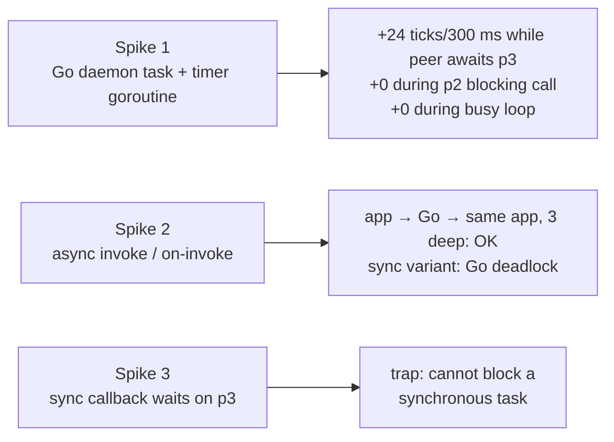

# dapr-wasm-components go Family: Async, Threads and Queues

> Sources: dapr-wasm-components go-async research and spikes, 2026-11-13; Dapr on TinyGo feasibility test, 2026-11-13; golang/go#77141, 2026-01-09
> Raw: [go-async research and spikes](../../raw/dapr/2026-11-13-go-async-wasm-research.md); [Dapr on TinyGo feasibility](../../raw/dapr/2026-11-13-dapr-on-tinygo-feasibility.md); [golang/go#77141 wasip3 proposal](../../raw/dapr/2026-01-09-golang-wasip3-port-proposal.md)

## Overview

The go family (Dapr embedded via componentize-go) has two structural limits ([go Family § Limits](dapr-wasm-components-go-family.md#limits)):

1. **Dapr does not run on its own.** Go's goroutines run only while go-outbound is on the call stack. During an app callback, Dapr is frozen.
2. **The app cannot be called again while it is busy.** One app instance, one delivery at a time; self-invocation fails fast, A → B → A hangs.

Both come from the WASI 0.2 sync model: one thread of control per store, and a sync call holds every instance on its stack. This page records which Wasm features can lift the limits, what the spikes measured, and the plan.

## Which Wasm features help

| Feature | Status (2026-11) | Helps? |
|---|---|---|
| **WASI 0.3 / Component Model async** (async funcs, waitable sets, callback ABI) | WASI 0.3.0 final (June 2026); on by default in wasmtime 49; componentize-go 0.5.x with a patched Go | **Yes — the only practical lever.** An async Go task can stay alive and be resumed by the host event loop; async-typed functions let a caller wait without holding the instance. |
| Reentrance rule change (CM PR #705) | Spec merged 2026-08; wasmtime 49 passes `reentrance.wast` | Yes, with async: app → Dapr → same app no longer traps. |
| CM cooperative threads (`thread.new-indirect`, …) | Behind `-W component-model-threading`, "very incomplete" | Not for big Go: Go has its own scheduler. TinyGo's pending wasip3 work (go-pkg glue) maps goroutines to CM threads; released TinyGo 0.44 (`wasip2`) still uses asyncify. Dapr does not build with TinyGo (see below). |
| wasi-threads | Legacy (WASI 0.1 only) | No: incompatible with components. |
| shared-everything-threads | Phase 1 | Not yet: big Go has no wasm threads (golang/go#28631). |
| Stack switching | Phase 3 | Indirect: a future Go backend (golang/go#81963); no effect today. |
| Queues | — | Already used (`go-events`). A queue helps only if the consumer can run while the producer waits — that again needs async. |

## Spike results

Code: `spikes/go-async/` in SPIKES_PR (kept out of `main`); wasmtime 49.0.2.

Consequences:

- Go can run **independently** as a never-returning async task, but only when everything else in the store waits through p3 async. A p2 blocking call or a busy loop elsewhere still freezes it (single thread).
- Self-invocation and concurrent deliveries need **async-typed WIT functions** on both sides: the app's callbacks and the building blocks that can wait on the app. Sync-typed functions cannot yield.
- Today's sync-typed callbacks cannot wait on p3 imports at all. So the go-only change (below) does not unfreeze Dapr during callbacks of existing apps.
- The patched Go's idle hook ignores Go timers. An async Go task must keep a clock wait pending (a tick) so timer-driven goroutines run; latency of a newly set timer is up to one tick.
- The go-pkg glue exits a task that is idle with no pending waitable, even before `task.return`. Go async exports must wait on Go channels with a clock wait of their own pending.

## Plan (stacked)

1. **Research** (this page) **+ spikes** (SPIKES_PR).
2. **Go-only async.** Private `go.wit` goes async (`run` daemon task, async `next-event`), go-inbound becomes a WASIp3 pump (`wasi:cli/run@0.3.0`), componentize-go async build. Public interfaces unchanged. Foundation for step 3.
3. **interfaces 0.8 async.** Building blocks and `*-callback` functions become `async func` (breaks the "WIT stays sync" rule). All providers, the `dapr-app` SDK (async Rust apps) and the E2Es follow. Fixes self-invocation, concurrent deliveries and frozen Dapr while the app awaits Dapr or p3 I/O.

## Other alternatives

Ranked by value for the go family:

1. **daprd as a wasm sidecar.** go-outbound already serves daprd's HTTP/gRPC API (the E2E calls `/v1.0/invoke` on it). Run it as its own `wasmtime run` process (Go always on the stack, so it always runs) with the normal app channel, and serve the app with the sidecar families under `wasmtime serve`/Spin (fresh or reused instance per request). Gives independence, concurrency and self-invocation today, without async — but gives up the typed in-process calls and adds a process boundary.
2. **More app instances in the composition** (wac can instantiate the app N times). Only useful together with async (the pump must be able to wait); with sync calls the pump is on the stack and cannot dispatch.
3. **Host-side pump.** A custom wasmtime embedding that pulls `go-events` and instantiates the app per delivery. Breaks "no native host".
4. **TinyGo + CM threads.** Goroutines as CM threads with timer-aware waits. Tested with TinyGo 0.44.0: feasible only with heavy forks, about 10–20 person-weeks ([raw](../../raw/dapr/2026-11-13-dapr-on-tinygo-feasibility.md)):
   - protobuf-go works after a ~6-line patch (reflect `MethodByName`); grpc-go builds after 5 build-tag patches but cannot dial (TinyGo `net` has no wasi:sockets backend).
   - A minimal Dapr subset pulls 1145 packages and fails in Azure azcore (`http.Transport.ForceAttemptHTTP2`, `tls.RenegotiateFreelyAsClient`).
   - Blockers: stub `crypto/tls`, no wasi:sockets `net`, reflect `Method`/`Call` unimplemented (tinygo#3862), json-iterator/reflect2 linknames, build scale (tinygo#5840), `wasip2` = `linux/arm` drags in Linux-only code. No released wasip3 target yet.
   - A slim TinyGo "Dapr-lite" (building blocks over small clients) is cheaper (4–8 person-weeks) but loses component breadth.
5. **Upstream `GOOS=wasip3`** (golang/go#77141): would move the scheduler/host bridge, timers included, into the Go runtime. Wait and adopt. Status 2026-11-13: proposal not accepted; Step 0 (`runtime.wasiOnIdle`, golang/go#76775) still open; one prototype branch. Would let the async go build (steps 2–3) drop: the patched Go, the `net`/netpoll overlay, the polling clock ticks that a Go async task needs today (spike finding above) and (probably) any hand-written offload of export bodies to goroutines. Would **not** give parallelism or stop a busy app callback from freezing Dapr (same store, one thread), and would not make the 0.8 async WIT unnecessary.

## See Also

- [dapr-wasm-components go Family](dapr-wasm-components-go-family.md)
- [dapr-wasm-components Architecture](dapr-wasm-components-architecture.md)
- [dapr-wasm-components Inbound Design](dapr-wasm-components-inbound-design.md)
- [Component Model Overview](../wasm-component-model/component-model-overview.md)
- [WIT Format](../wasm-component-model/wit-format.md)
