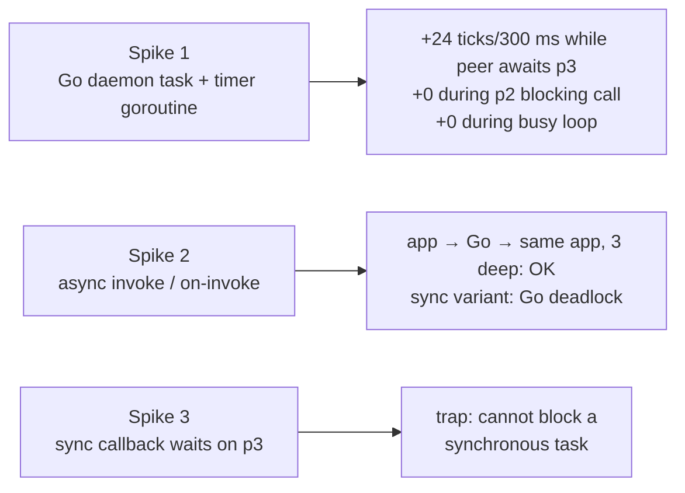

# dapr-wasm-components go Family: Async, Threads and Queues

> Sources: dapr-wasm-components go-async research and spikes, 2026-11-13; Dapr on TinyGo feasibility test, 2026-11-13; golang/go#77141, 2026-01-09; go family without async-typed WIT research, 2026-11-14; async WIT with sync-ABI guests check, 2026-11-14; scala-wasm Future and async gaps, 2026-11-14; scala-wasm pull requests #268–#271, 2026-11-14; scala-wasm @WitAsync PR notes, 2026-11-14
> Raw: [scala-wasm @WitAsync PR notes](../../raw/dapr/2026-11-14-scala-wasm-witasync-pr-notes.md); [scala-wasm upstream contribution facts](../../raw/dapr/2026-11-14-scala-wasm-upstream-contribution-facts.md); [scala-wasm Future and async gaps](../../raw/dapr/2026-11-14-scala-wasm-future-and-async-gaps.md); [go-async research and spikes](../../raw/dapr/2026-11-13-go-async-wasm-research.md); [Dapr on TinyGo feasibility](../../raw/dapr/2026-11-13-dapr-on-tinygo-feasibility.md); [golang/go#77141 wasip3 proposal](../../raw/dapr/2026-01-09-golang-wasip3-port-proposal.md); [without async-typed WIT](../../raw/dapr/2026-11-14-go-family-without-async-wit-research.md); [async WIT with sync-ABI guests](../../raw/dapr/2026-11-14-async-wit-sync-abi-guest-check.md)

## Overview

The go family (Dapr embedded via componentize-go) has two structural limits ([go Family § Limits](dapr-wasm-components-go-family.md#limits)):

1. **Dapr does not run on its own.** Go's goroutines run only while go-outbound is on the call stack. During an app callback, Dapr is frozen.
2. **The app cannot be called again while it is busy.** One app instance, one delivery at a time; self-invocation fails fast, A → B → A hangs.

Both come from the WASI 0.2 sync model: one thread of control per store, and a sync call holds every instance on its stack. This page records which Wasm features can lift the limits, what the spikes measured, and the plan.

## Which Wasm features help

| Feature | Status (2026-11) | Helps? |
|---|---|---|
| **WASI 0.3 / Component Model async** (async funcs, waitable sets, callback ABI) | WASI 0.3.0 final (June 2026); on by default in wasmtime 49; componentize-go 0.5.x with a patched Go | **Yes — the only practical lever.** An async Go task can stay alive and be resumed by the host event loop; async-typed functions let a caller wait without holding the instance. |
| Reentrance rule change (CM PR #705) | Spec merged 2026-08; wasmtime 49 passes `reentrance.wast` | Yes, with async: app → Dapr → same app no longer traps. |
| CM cooperative threads (`thread.new-indirect`, …) | Behind `-W component-model-threading`, "very incomplete" | Not for big Go: Go has its own scheduler. TinyGo's pending wasip3 work (go-pkg glue) maps goroutines to CM threads; released TinyGo 0.44 (`wasip2`) still uses asyncify. Dapr does not build with TinyGo (see below). |
| wasi-threads | Legacy (WASI 0.1 only) | No: incompatible with components. |
| shared-everything-threads | Phase 1 | Not yet: big Go has no wasm threads (golang/go#28631). |
| Stack switching | Phase 3 | No: the Go backend (golang/go#81963, Go 1.28, `GOWASM=stackswitch`) is "invisible to programmers" — it changes how goroutine switches compile, not when goroutines run. |
| Queues | — | Already used (`go-events`). A queue helps only if the consumer can run while the producer waits — that again needs async. |

## Spike results

Code: [spikes/go-async](../../spikes/go-async/README.md); wasmtime 49.0.2.

Consequences:

- Go can run **independently** as a never-returning async task, but only when everything else in the store waits through p3 async. A p2 blocking call or a busy loop elsewhere still freezes it (single thread).
- Self-invocation and concurrent deliveries need **async-typed WIT functions** on both sides: the app's callbacks and the building blocks that can wait on the app. Sync-typed functions cannot yield.
- Today's sync-typed callbacks cannot wait on p3 imports at all. So the go-only change (below) does not unfreeze Dapr during callbacks of existing apps.
- The patched Go's idle hook ignores Go timers. An async Go task must keep a clock wait pending (a tick) so timer-driven goroutines run; latency of a newly set timer is up to one tick.
- The go-pkg glue exits a task that is idle with no pending waitable, even before `task.return`. Go async exports must wait on Go channels with a clock wait of their own pending.

## Plan (stacked)

1. **Research** (this page) **+ spikes** ([spikes/go-async](../../spikes/go-async/README.md)).
2. **Go-only async.** Private `go.wit` goes async (`run` daemon task, async `next-event`), go-inbound becomes a WASIp3 pump (`wasi:cli/run@0.3.0`), componentize-go async build. Public interfaces unchanged. Foundation for step 3.
3. **interfaces 0.8 async.** Building blocks and `*-callback` functions become `async func` (breaks the "WIT stays sync" rule). All providers, the `dapr-app` SDK (async Rust apps) and the E2Es follow. Fixes self-invocation, concurrent deliveries and frozen Dapr while the app awaits Dapr or p3 I/O.

## Can the public WIT stay sync?

Researched 2026-11-14 (web only, no spikes). **In one store: no full fix.** Outside one store, or with partial fixes: yes.

Why one store needs `async` in the type:

- The spec makes "may block" a property of the function type: "non-`async` functions are not allowed to block". The `async` ABI option "is only allowed when used with an `async` function type". So during a sync-typed callback nothing else in the store runs except what the callback calls.
- WASI 0.2 `pollable` cannot be forwarded by a component between the host and its caller (the "sandwich problem"). So a shim that lets Go run while the app waits in `wasi:io/poll` is not practical. WASI 0.3 exists to fix this.
- Not levers: threads (shared-everything-threads Phase 1; CM cooperative threads off by default and "do not allow a single component instance to increase its internal parallelism"; one store = one OS thread), upstream Go (all wasm issues open), `go:wasmexport` (goroutines "will be paused" after the export returns, by design), WASIX (no Component Model), runtime instantiation (CM issue #423, no draft).

Options that keep the WIT sync, best first:

| Option | Limit 1 (Dapr frozen) | Limit 2 (re-entry) | Cost |
|---|---|---|---|
| **A. Wasm sidecar** (alternative 1 below) | Fixed, real parallelism | Fixed (host makes app instances) | Process boundary; HTTP/gRPC between provider and Dapr. The app's WIT does not change. |
| **B. Nested pump in the SDK** | No change | Fixed for nested calls (self-invocation, A → B → A) | Additive sync WIT: a pull-based events import for the app. Handlers must tolerate nested runs. Own design, not spiked. |
| **C. Async as an addition** | Fixed for apps that use the async interfaces | Fixed for those apps | Two interface sets to maintain. Sync apps keep both limits. |
| **D. Yield call** | Reduced: a long callback calls a sync `yield` so Go runs | No change | Small. Cooperative only. |

- **A** is the only complete fix with no async. No standard host gives typed sync WIT across stores: wRPC removed import polyfilling on 2026-11-13 ("always fragile and a potential footgun"), wasmCloud host component plugins require `async func` for calls into workloads, Spin and the wasmtime CLI have no typed cross-store call. So the boundary is HTTP/gRPC, which the sidecar families already speak.
- **B** works because instantiation is acyclic: no provider can call the app, so a nested delivery can reach the app only on the return path of a building-block call. The SDK waits in a loop, pulls an event for this app, and runs the handler as a plain in-instance call.
- **C** softens step 3 of the plan. `async func` is a type marker for "may block", not a demand for async code: wit-bindgen's `sync: true` gives sync Rust bindings for async WIT functions. A sync-lifted app then lets Dapr run while it waits on Dapr or p3 I/O, but it still cannot be re-entered (the spec: it "will deadlock").

## Async WIT and guests that know only the sync ABI

Checked 2026-11-14 for scala-wasm, the toolchain of dapr4s ([raw](../../raw/dapr/2026-11-14-async-wit-sync-abi-guest-check.md)):

- A core module with the plain sync ABI builds against an async-typed WIT: `wasm-tools component embed` + `component new` give `async func` types with no `async` canon option. Two such components composed with `wac plug` and ran on wasmtime 49.0.2.
- A component built against the sync WIT does **not** plug into an async-typed provider. Every app must be rebuilt for 0.8.0.
- A bindings generator can ignore `async`: wit-bindgen-scala 0.1.0 gives byte-identical output for `func` and `async func`. It panics on `stream`/`future` types.
- The component type must come from the real WIT. scala-wasm's linker reconstructs the type from its IR, which has no async flag. dapr4s re-embeds the WIT with wasm-tools, so it is not affected while it keeps that step.
- Such a guest is sync-lifted: one delivery at a time per instance, and self-invocation in the go family waits on itself (see C above). With the sidecar families the host makes the instances, so nothing changes.

### `async func`, `future<T>` and a guest `Future`

Three different layers ([raw](../../raw/dapr/2026-11-14-scala-wasm-future-and-async-gaps.md)):

| Thing | What it is | Who sees it |
|---|---|---|
| WIT `async func` | A marker on the function type: the call may block | Both components; checked at composition |
| Subtask | A handle to a call in progress, returned by an async-lowered import | The caller only (Canonical ABI, not a WIT type) |
| WIT `future<T>` | A value type: a one-shot channel passed as a parameter or result | Both components |
| Scala `Future[T]` | A library type with an execution context | Scala code only |

- interfaces 0.8.0 uses only `async func`. It has no `future<T>` or `stream<T>`.
- The bindings generator chooses the mapping: an async-lowered import can become a `Future[T]` (as Rust gets `async fn`) or stay a blocking direct-style call.
- scala-wasm today: `ExecutionContext.global` in component mode is a single-threaded queue that runs every task before the call returns. A `Future` works but cannot wait on anything outside the instance. There is no event loop; the maintainers want one as an external library (scala-wasm#218), because the core must not know WASI.

What scala-wasm needs, smallest first:

1. An async flag in the IR `FuncType`, written by wit-bindgen-scala and emitted by the linker. Then the linker's own component type is correct and the wasm-tools re-embed step can go. It spans the compiler plugin, the serialized IR, the linker and wit-bindgen-scala (a separate repository). Opened as [scala-wasm#273](https://github.com/scala-wasm/scala-wasm/pull/273) (2026-11-14): a `@WitAsync` annotation, `wit.FuncType.isAsync`, a new IR tag `TagWITAsyncFuncType` (old IR still reads, so no format break) and functype `0x43` in the linker. Its e2e test calls the async exports from a Rust component with both the async and the sync ABI (built with plain `cargo build` and wit-bindgen 0.63, because cargo-component 0.21.1 encodes `async func` with the old `[async]` prefix). The caller's entry point must itself be `async func`: a sync-typed task that waits traps ("cannot block a synchronous task before returning"). wit-bindgen-scala (a separate repository) must still emit `@WitAsync`.
2. Async lower for imports (subtasks, waitable sets). One handler can then run several calls at the same time.
3. Async lift for exports. The callback ABI fits `Future`-style code. Direct-style code (dapr4s) needs the stackful ABI (wasmtime 49: opt-in flag), Component Model threads or core stack switching. This is the step that removes "one delivery at a time".
4. An event-loop execution context driven by waitable sets (the library of scala-wasm#218).
5. `future<T>`, `stream<T>` and `error-context` in the IR, the linker and wit-bindgen-scala. Necessary for WASI 0.3 interfaces such as `wasi:http@0.3`.

Order: 1 → 2 → 3 and 5 (3 and 5 do not depend on each other). Item 4 has two parts: the wait loop on Component Model waitable sets is part of item 3 (no WASI in it); a general scheduler is the external library.

How to bring this upstream ([raw](../../raw/dapr/2026-11-14-scala-wasm-upstream-contribution-facts.md)): one maintainer reviews everything. Small fixes merged in 2 to 27 days. The one feature PR (#270) was closed: no AI-assisted code near the javalib, and the maintainer wanted to own the design. So: an issue with the design questions first, a PR for item 1 only, and no stack of unrequested feature PRs.

## Other alternatives

Ranked by value for the go family:

1. **daprd as a wasm sidecar.** go-outbound already serves daprd's HTTP/gRPC API (the E2E calls `/v1.0/invoke` on it). Run it as its own `wasmtime run` process (Go always on the stack, so it always runs) with the normal app channel, and serve the app with the sidecar families under `wasmtime serve`/Spin (fresh or reused instance per request). Gives independence, concurrency and self-invocation today, without async — but gives up the typed in-process calls and adds a process boundary. wasmCloud v2 has this shape built in: one long-running "service" per workload, reached by components over in-runtime loopback TCP only ("Components **cannot** call into the service via WIT interfaces").
2. **More app instances in the composition** (wac can instantiate the app N times). Only useful together with async (the pump must be able to wait); with sync calls the pump is on the stack and cannot dispatch.
3. **Host-side pump.** A custom wasmtime embedding that pulls `go-events` and instantiates the app per delivery. Breaks "no native host".
4. **TinyGo + CM threads.** Goroutines as CM threads with timer-aware waits. Tested with TinyGo 0.44.0: feasible only with heavy forks, about 10–20 person-weeks ([raw](../../raw/dapr/2026-11-13-dapr-on-tinygo-feasibility.md)):
   - protobuf-go works after a ~6-line patch (reflect `MethodByName`); grpc-go builds after 5 build-tag patches but cannot dial (TinyGo `net` has no wasi:sockets backend).
   - A minimal Dapr subset pulls 1145 packages and fails in Azure azcore (`http.Transport.ForceAttemptHTTP2`, `tls.RenegotiateFreelyAsClient`).
   - Blockers: stub `crypto/tls`, no wasi:sockets `net`, reflect `Method`/`Call` unimplemented (tinygo#3862), json-iterator/reflect2 linknames, build scale (tinygo#5840), `wasip2` = `linux/arm` drags in Linux-only code. No released wasip3 target yet.
   - A slim TinyGo "Dapr-lite" (building blocks over small clients) is cheaper (4–8 person-weeks) but loses component breadth.
5. **Upstream `GOOS=wasip3`** (golang/go#77141): would move the scheduler/host bridge, timers included, into the Go runtime. Wait and adopt. Status 2026-11-13: proposal not accepted; Step 0 (`runtime.wasiOnIdle`, golang/go#76775) still open; one prototype branch. Would let the async go build (steps 2–3) drop: the patched Go, the `net`/netpoll overlay, the polling clock ticks that a Go async task needs today (spike finding above) and (probably) any hand-written offload of export bodies to goroutines. Would **not** give parallelism or stop a busy app callback from freezing Dapr (same store, one thread), and would not make the 0.8 async WIT unnecessary.

## See Also

- [dapr-wasm-components go Family](dapr-wasm-components-go-family.md)
- [dapr-wasm-components Architecture](dapr-wasm-components-architecture.md)
- [dapr-wasm-components Inbound Design](dapr-wasm-components-inbound-design.md)
- [Component Model Overview](../wasm-component-model/component-model-overview.md)
- [WIT Format](../wasm-component-model/wit-format.md)
