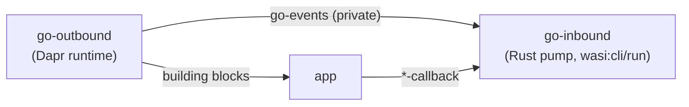

# dapr-wasm-components go Family (Dapr Embedded)

> Sources: dapr-wasm-components go-family session, 2026-10-12
> Raw: [go family findings](../../raw/dapr/2026-10-12-go-family-embedded-dapr-findings.md)

## Overview

The third provider family, `dapr-wasm-components-go-outbound` / `-go-inbound`, embeds **Dapr itself** — `github.com/dapr/dapr` v1.18, the code daprd runs — in the composed app: no sidecar, no HTTP/gRPC between the app and Dapr. go-outbound is big Go compiled with `componentize-go`; go-inbound is a small Rust pump. Apps are unchanged (same `app` world). The shared real-Dapr scenario passes with it. The price: a ~264 MB component, Go std patches, and the limits of a single long-lived app instance.

## Shape: one runtime, pull-based inbound

A component that both exports the building blocks and imports the app's callbacks is impossible in principle: instantiation must be acyclic, and a callback that calls back into the provider would re-enter an instance on the stack (the component model traps). So the family is split, but — unlike the sidecar families — into **one engine and one connector**:

- go-outbound exports the public `outbound` world plus the private `dapr-wasm-components:go/events` (`attach`, `next-event`, `complete-event`), defined in `components/go-outbound/wit/go.wit`. Its records are structural copies of the callback records: `use`-ing the callback interfaces would force go-outbound to import them from the app (a cycle).
- go-inbound loops: pull an event, call the matching callback, hand the result back. While it calls the app, go-outbound is not on the stack, so the app may call any building block.
- The composed app holds exactly one Go runtime and one Dapr runtime; the pump is Rust because a Go pump would add a second Go runtime.

## How go-outbound works

- **Boot.** `internal/daprrt` mirrors daprd's `runWithContext`, parsing the component's program arguments with daprd's own flag parser — `wasmtime run composed.wasm --app-id x --resources-path /r` configures it like daprd. The API object comes from the unexported `DaprRuntime.daprGRPCAPI` (reflection, field names checked at start).
- **Outbound.** Each export calls the in-process gRPC API object (`runtimev1pb.DaprServer`) — the same protos as `wasi-grpc-outbound`, whose mappings it mirrors. Calls get non-empty incoming metadata run through Dapr's own metadata interceptor; skipping it made Dapr panic on a nil map.
- **Inbound.** Dapr's app channel speaks its HTTP app protocol to `127.11.11.11:80`, a virtual endpoint that `wasisock` serves with in-memory `net.Pipe`s into an `http.Handler` (a Go port of `wasi-http-inbound`'s router), which queues typed events. Configuration updates are queued directly from the in-process subscription stream.
- **Network.** Go's wasip1 `net` is an in-process fake. A `go build -overlay` (std only — GOMODCACHE files cannot be overlaid) patches `net` to call hooks that `wasisock` fills with `wasi:sockets` TCP/DNS; waits are cooperative (non-blocking + sleep backoff) because all goroutines share one thread. Wildcard listens bind IPv4: wasi:sockets IPv6 sockets are IPv6-only.
- **Runtime patch.** A GC can start inside `cabi_realloc`, and its start-the-world `netpoll(0)` calls `poll_oneoff` — an import, forbidden there ("cannot leave component instance"). The overlay skips that no-op poll.
- **Components.** `scripts/gen-components.py` copies daprd's registration files: the stable set minus what does not build for wasip1 (sqlite via modernc libc, Pulsar, Dubbo, some Azure SDKs), plus crypto, Consul, the Redis lock and conversation.
- **Defaults.** `HotReload` (default-on, fsnotify) is turned off via `go:linkname` on `config.defaultFeatures`; metrics are off unless enabled.

## Limits

- **One app instance.** A delivery cannot reach the app while it runs a callback. Self-invocation would deadlock, so it fails fast with `app-unreachable`; the shared scenario asserts exactly that (`Endpoints::self_invocation`). An A → B → A cycle hangs unless a resiliency timeout is set. The sidecar families avoid this because their hosts instantiate per request.
- Go goroutines run only while go-outbound is on the stack; a long callback that never calls Dapr pauses subscribers and heartbeats.
- No UDP multicast → no mDNS; `nameformat` cannot give per-app ports on one host. Use Consul (set `DAPR_HOST_IP`), Kubernetes, or another resolver. Dapr resolves even its own app id before short-circuiting to a local call.
- Size ~264 MB (Dapr runtime ~138 MB + component SDKs); first wasmtime compile ~30 s.
- Toolchain bugs worked around in `scripts/fix-bindings.py`: a wit-bindgen-go name clash (variant case vs record type) and `FromOwnHandle` not recording the incoming handle.

## See Also

- [dapr-wasm-components Architecture](dapr-wasm-components-architecture.md)
- [dapr-wasm-components Inbound Design](dapr-wasm-components-inbound-design.md)
- [gRPC to Dapr from Wasm](dapr-grpc-from-wasm.md)
- [Component Model Overview](../wasm-component-model/component-model-overview.md)
