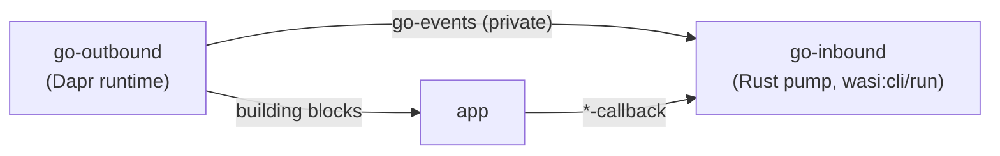

# dapr-wasm-components go Family (Dapr Embedded)

> Sources: dapr-wasm-components go-family session, 2026-10-12; in-process app callbacks, 2026-10-14; go-async research, WASI 0.3 pump and async interfaces 0.8.0, 2026-11-13
> Raw: [go family findings](../../raw/dapr/2026-10-12-go-family-embedded-dapr-findings.md)

## Overview

The third provider family, `dapr-wasm-components-go-outbound` / `-go-inbound`, embeds **Dapr itself** — `github.com/dapr/dapr` v1.18, the code daprd runs — in the composed app: no sidecar, no HTTP/gRPC between the app and Dapr. go-outbound is big Go compiled with `componentize-go`; go-inbound is a small Rust pump. Apps are unchanged (same `app` world). The shared real-Dapr scenario passes with it. The price: a ~264 MB component, Go std patches, and the limits of a single long-lived app instance.

## Shape: one runtime, pull-based inbound

A component that both exports the building blocks and imports the app's callbacks is impossible in principle: instantiation must be acyclic, and a callback that calls back into the provider would re-enter an instance on the stack (the component model traps). So the family is split, but — unlike the sidecar families — into **one engine and one connector**:

- go-outbound exports the public `outbound` world plus the private `dapr-wasm-components:go/events` (`attach`, `next-event`, `complete-event`), defined in `components/go-outbound/wit/go.wit`. Its records are structural copies of the callback records: `use`-ing the callback interfaces would force go-outbound to import them from the app (a cycle).
- go-inbound loops: pull an event, call the matching callback, hand the result back. While it calls the app, go-outbound is not on the stack, so the app may call any building block.
- The composed app holds exactly one Go runtime and one Dapr runtime; the pump is Rust because a Go pump would add a second Go runtime.
- **WASI 0.3 async (since 2026-11-13, `go@0.2.0`).** `events.run` (never returns) and `events.next-event` are `async`; go-inbound exports `wasi:cli/run@0.3.0`, starts `run` without awaiting it and awaits `next-event`. go-outbound is built by componentize-go as an async component with the patched Go (`runtime.wasiOnIdle`, golang/go#76775). Rules learned from the go-pkg callback glue: a task resumes only on its own waitable; an idle task with no pending waitable is ended (even before `task.return`); an export goroutine must not be woken in another task's turn. So `run` keeps a clock wait aimed at the next Go timer (`runtime.wasiNextTimer`, added by the overlay; clamped to 0.2–10 ms) and `next-event` polls the queue between clock waits (`events.Wait`, 0.5→10 ms backoff). Since interfaces 0.8.0 the building blocks are async exports too: `scripts/fix-bindings.py` rewrites each glue call `resultN := export_x.F(args)` to `events.CallN(export_x.F, args)`, which runs the body in its own goroutine while the export goroutine waits with `events.Wait`. Details and spikes: [go Family: Async, Threads and Queues](dapr-wasm-components-go-async.md).

## How go-outbound works

- **Boot.** `internal/daprrt` mirrors daprd's `runWithContext`, parsing the component's program arguments with daprd's own flag parser — `wasmtime run composed.wasm --app-id x --resources-path /r` configures it like daprd. The API object comes from the unexported `DaprRuntime.daprGRPCAPI` (reflection, field names checked at start).
- **Outbound.** Each export calls the in-process gRPC API object (`runtimev1pb.DaprServer`) — the same protos as `wasi-grpc-outbound`, whose mappings it mirrors. Calls get non-empty incoming metadata run through Dapr's own metadata interceptor; skipping it made Dapr panic on a nil map.
- **Inbound (since 2026-10-14: Go calls, no HTTP).** `internal/appcallback` fills Dapr's two app seams, and every handler queues a typed event. Configuration updates are queued directly from the in-process subscription stream.
  - The runtime runs in **gRPC app-protocol mode**. Pub/sub, bulk pub/sub, input bindings and the two subscription lists go through a `grpc.ClientConnInterface`; `appcallback.Conn` is no connection — it switches on the method name and passes the typed protobuf request to a handler (`wasi-grpc-inbound`'s mapping, minus the framing). It is registered with the public `Manager.SetAppClientConn`.
  - Invocation, jobs, actors, the actor config and health probes go through `channel.AppChannel`, which `appcallback.Channel` implements directly. Dapr's actor runtime still calls it with `actors/<type>/<id>/method/...` methods and a JSON timer/reminder body: those are Go structs, not HTTP. Jobs reach the app as JSON (`anyjson.UnpackJSON`).
  - **Wiring, no Dapr patch** (GOMODCACHE files cannot be overlaid). `daprrt.attach`, between `runtime.FromConfig` and `Run`, sets the unexported `Channels.appChannel` and zeroes the app port in `Channels`' private copy of the app connection config, so `Channels.Refresh` leaves the channel alone (its one warning is silenced by raising the `dapr.runtime.channels` logger to errors). All fields are checked at start.
  - **The app port stays non-zero** (`127.11.11.11:80`): Consul self-registration fails without `APP_PORT` (`metadata property missing: APP_PORT`), and Dapr waits for a TCP connect to the app port before delivering. `wasisock` accepts that connect in-process; no byte flows.
  - **Better than the HTTP channel it replaced**: no request/response serialization or parsing, no `net.Pipe` HTTP server, pub/sub data arrives as the envelope's bytes (no CloudEvent JSON re-encoding), no `/__dapr_wasm_components/pubsub` route trick, and input-binding replies are applied (`to`, `data`, `concurrency` — Dapr ignores the whole reply on the HTTP channel). Gaps: >100 concurrent `AppCallback` calls would make Dapr's pool dial a second connection (it would fail); Dapr's app HTTP middleware pipeline and app token do not apply.
- **Network.** Go's wasip1 `net` is an in-process fake. A `go build -overlay` (std only — GOMODCACHE files cannot be overlaid) patches `net` to call hooks that `wasisock` fills with `wasi:sockets` TCP/DNS; waits are cooperative (non-blocking + sleep backoff) because all goroutines share one thread. Wildcard listens bind IPv4: wasi:sockets IPv6 sockets are IPv6-only.
- **Runtime patch.** A GC can start inside `cabi_realloc`, and its start-the-world `netpoll(0)` calls `poll_oneoff` — an import, forbidden there ("cannot leave component instance"). The overlay skips that no-op poll.
- **Components.** `scripts/gen-components.py` copies daprd's registration files: the stable set minus what does not build for wasip1 (sqlite via modernc libc, Pulsar, Dubbo, some Azure SDKs), plus crypto, Consul, the Redis lock and conversation.
- **Defaults.** `HotReload` (default-on, fsnotify) is turned off via `go:linkname` on `config.defaultFeatures`; metrics are off unless enabled.

## Limits

- **One app instance, re-entrant since interfaces 0.8.0.** The callbacks and building blocks are `async func`; go-inbound runs each delivery as its own task, and go-outbound lifts every building block with the async ABI (componentize-go). While a callback awaits Dapr, other deliveries run in the same instance — self-invocation works (the shared scenario asserts it in all three suites). Before 0.8.0 it failed fast with `app-unreachable`.
- One thread per store: a callback that computes without awaiting holds everything (Dapr's goroutines, other deliveries).
- Background and spikes: [go Family: Async, Threads and Queues](dapr-wasm-components-go-async.md).
- No UDP multicast → no mDNS; `nameformat` cannot give per-app ports on one host. Use Consul (set `DAPR_HOST_IP`), Kubernetes, or another resolver. Dapr resolves even its own app id before short-circuiting to a local call.
- Size ~264 MB (Dapr runtime ~138 MB + component SDKs); first wasmtime compile ~30 s.
- Toolchain bugs worked around in `scripts/fix-bindings.py`: a wit-bindgen-go name clash (variant case vs record type), `FromOwnHandle` not recording the incoming handle, an async export's `task.return` called with a `uintptr` for an `int32` parameter, and a header line that is not Go's `// Code generated ... DO NOT EDIT.` marker. The generated Go is checked in (Go tools do not run generators); CI regenerates it and fails on drift, and `.gitattributes` marks it `linguist-generated`.

## See Also

- [dapr-wasm-components Architecture](dapr-wasm-components-architecture.md)
- [dapr-wasm-components Inbound Design](dapr-wasm-components-inbound-design.md)
- [gRPC to Dapr from Wasm](dapr-grpc-from-wasm.md)
- [go Family: Async, Threads and Queues](dapr-wasm-components-go-async.md)
- [Component Model Overview](../wasm-component-model/component-model-overview.md)
