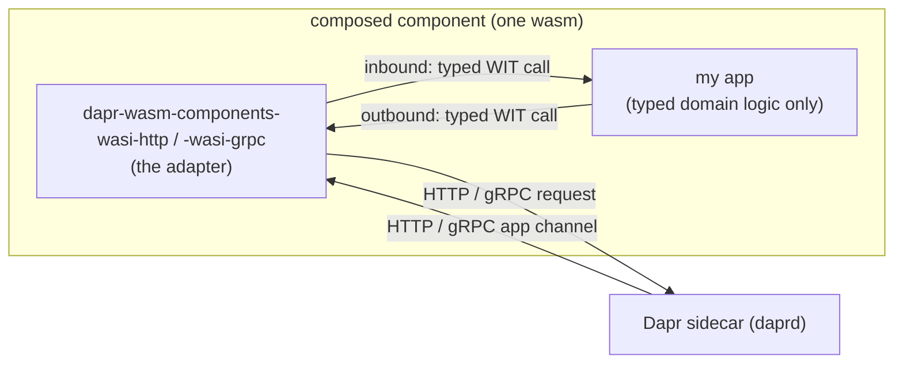
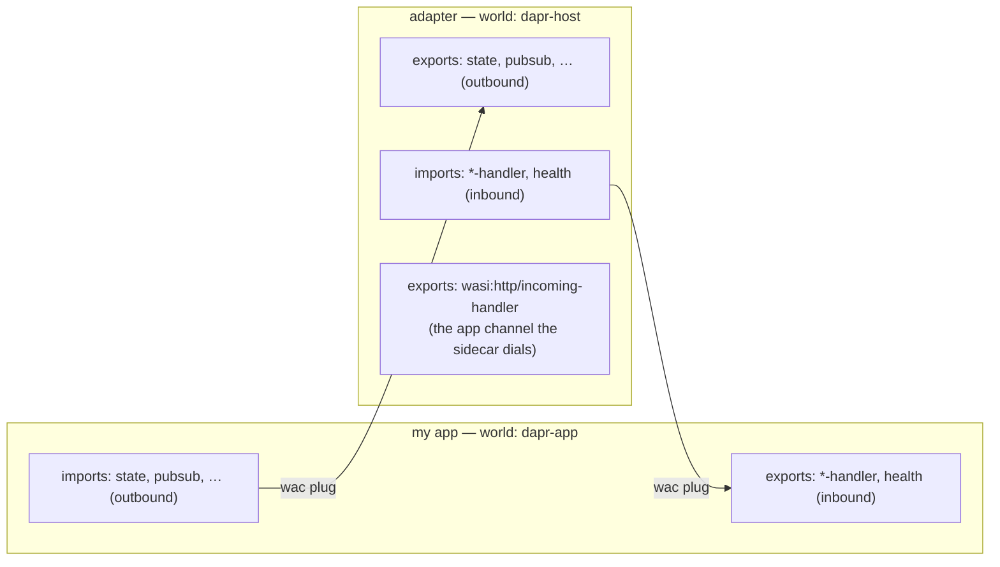
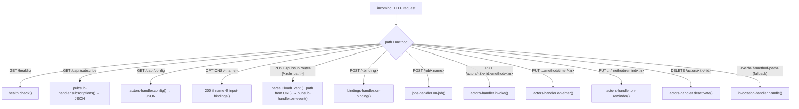

# dapr-wasm-components — Inbound Design (Dapr → app, typed)

> Sources: design interview with Ondra (2026-06-13); this repository (components/wit/, components/wasi-*-inbound/, app-sdk/, e2e/); status refreshed against the code 2026-10-10
>
> Status: **implemented** (built 2026-06-13; package now `@0.7.5`). Authored from a design interview with Ondra, then built. Supersedes the prior "inbound goes through a plain `wasi:http/incoming-handler` on the app" decision in [Architecture](dapr-wasm-components-architecture.md) (§Key decisions, "Outbound only"). The sections below keep the **original proposal**; where the build differs, the as-built list here wins.
>
> **As-built (2026-10-10):**
> - **WIT**: seven `*-callback` interfaces (`invocation-`, `pubsub-`, `bindings-`, `jobs-`, `actors-`, `configuration-`, `health-callback`) + outbound `configuration.subscribe`/`unsubscribe` (introduced in `@0.2.0`; since `@0.7.0` `subscribe` returns a `subscription` resource whose drop unsubscribes, and `configuration-callback` takes `configuration-item` from `configuration-read` — see [Architecture §Interfaces 0.7.0](dapr-wasm-components-architecture.md)). Worlds **`app`**, **`outbound`**, **`inbound`** (not the `dapr-app`/`dapr-host` working names below). Callback names follow Dapr's `AppCallback` proto (`on-invoke`, `list-topic-subscriptions`/`on-topic-event`, `list-input-bindings`/`on-binding-event`, `on-job-event`, `on-configuration-event`, `health-check`; actors `config`/`on-invoke`/`on-timer`/`on-reminder`/`deactivate`). Callbacks fail gracefully with `types.app-error { message }` (the shared `error` in the proposal below was removed in `0.5.0`) or by trapping.
> - **wasi-http inbound** (`components/wasi-http-inbound/`): routes `/healthz`, `/dapr/subscribe`, `/dapr/config`, `OPTIONS /<binding>`, a fixed internal pub/sub route (`/__dapr_wasm_components/pubsub`, not a per-subscription route), `/job/<name>`, `/configuration/…` update pushes, `/actors/…`, and falls back to service invocation.
> - **wasi-grpc inbound** (`components/wasi-grpc-inbound/`): built by hand-rolling gRPC framing + the `grpc-status` trailer over `wasi:http/incoming-handler` (the `wasi-grpc` crate is client-only; no tonic server). Serves `AppCallback` `OnInvoke`, `ListTopicSubscriptions`, `OnTopicEvent`, `ListInputBindings`, `OnBindingEvent`, `OnJobEvent`, and `AppCallbackHealthCheck.HealthCheck`; other methods return `UNIMPLEMENTED`. No actor hosting (not in `AppCallback`) and no configuration-update route. Verified over Spin inbound h2c with `grpcurl`; **no automated daprd `--app-protocol grpc` E2E yet**.
> - **`dapr-app` SDK** (`app-sdk/dapr-app/`): the "trivial defaults via Rust helper" decision, realized as a `DaprApp` trait with default methods + blanket Guest impls + a cross-crate `export_app!`. The demo apps (`e2e/apps/kv-demo`, `e2e/apps/microservice`) use it.
> - **e2e**: the mock suite drives a composed `outbound → app → inbound` server (`serve_inbound`, `compose::plug_full`); both real-Dapr suites use `wasi-http-inbound` (`dapr.rs` with `wasi-http-outbound`, `spin.rs` with `wasi-grpc-outbound`).
> - **Docs/CI/DX**: README two-directions section and interface tables done; CI publishes all four providers; `compose.wac` + `compose.sh` compose the three parts.
>
> **Remaining:** a daprd `--app-protocol grpc` E2E for `wasi-grpc-inbound`; bulk subscribe / routing rules (see limitations).
>
> Naming note: the working names `dapr-app`/`dapr-host` used below were superseded during implementation. The application world is **`app`** (closest to Dapr's own vocabulary — `app-id`/`app-port`/`AppCallback`), and the single provider was split into two direction-named worlds, **`outbound`** and **`inbound`**, so the composition graph `outbound → app → inbound` stays acyclic. (`host` was dropped because it collided with the wasm-host meaning; the provider worlds carry no `dapr-` prefix since it's redundant inside the `dapr-wasm-components:interfaces` package — see the [Architecture](dapr-wasm-components-architecture.md) world-naming note.) The outbound-only `dapr-client`/`dapr-server` worlds were removed (the SDK's defaults make a separate outbound-only world unnecessary).

## Goal

Today the providers cover only the **outbound** direction (app → Dapr): the app imports the building-block interfaces, the provider serves them and forwards to the sidecar. Inbound (Dapr → app) was deliberately left as a plain HTTP app channel the app served itself.

This redesign makes the providers handle **inbound too**, so the application **never touches HTTP (or gRPC) at all, in either direction**. The flow becomes symmetric:



*As built, the single "adapter" box is two components per transport (`*-outbound` exporting the building blocks, `*-inbound` serving the app channel), so the graph is `outbound → app → inbound` with no cycle.*

The adapter shields the app from the wire in both directions. The app is pure typed domain logic: it *imports* the building-block interfaces (to call Dapr) and *exports* the **handler** interfaces (to be called by Dapr).

## Decisions (from the interview)

| Topic | Decision |
|-------|----------|
| **Scope** | **All six inbound flows**, no exception: service invocation, pub/sub, input bindings, jobs, actors, configuration updates — plus app health checks. The app must never see HTTP/gRPC. |
| **Discovery** | App exports **typed discovery functions** (e.g. `subscriptions()`, `input-bindings()`, actor `config()`); the adapter renders the Dapr discovery responses (`/dapr/subscribe`, `OPTIONS <binding>`, `/dapr/config`) from them. Inspired by [dapr4s `DaprApp`](https://github.com/sideeffffect/dapr4s/blob/master/src/shared/DaprApp.scala) (route registry), adapted: WIT can't register closures, so the app returns metadata and the adapter dispatches by name/topic into a single handler per block. |
| **Handler shape** | **One interface per building block** (`invocation-handler`, `pubsub-handler`, `bindings-handler`, `jobs-handler`, `actors-handler`, `configuration-handler`, plus `health`). Each interface owns both its discovery function(s) and its delivery function(s). |
| **Optionality** | **One app world** (`dapr-app`) that *exports every* handler interface. The component model makes world exports mandatory, so an app implements all handlers even if it only does pub/sub — we ship a **Rust helper crate with trivial defaults** so unused handlers are one-liners (e.g. empty subscription list, `drop`-everything, healthy). Accepted tradeoff: simplest composition (no per-app stub-fill step, no world matrix) in exchange for mandatory-but-trivial exports. |
| **Service invocation** | **HTTP-faithful**: pass through verb / method-path / headers / query / body; the app returns status + headers + body. Symmetric with the outbound `invocation` interface; a non-2xx app response is a normal response, not an `error`. |
| **Pub/sub event** | **Typed `cloud-event` record** (id, source, type, spec-version, subject, time, topic, pubsub-name, data-content-type, data, extensions). The adapter parses the CloudEvent envelope; the app only deserializes its domain payload from `data`. |
| **Health** | **Always typed**: the app exports a `health` interface; the adapter delegates every `/healthz` probe to it. No auto-answer. |
| **Binding reply** | **Full Dapr input-binding response**: optional response `data` + `to` (output bindings to forward to) + state-store operations + concurrency. Lossless against the *documented* Dapr input-binding contract — but daprd only partly honours it (see [below](#binding-reply-what-daprd-really-does)). |
| **Providers** | **Both** `wasi-http` and `wasi-grpc` in scope. The typed handler WIT is **shared**; only the transport differs (wasi-http parses the HTTP app channel; wasi-grpc serves Dapr's `AppCallback` gRPC service). |

## Architecture: roles flip per direction

The adapter sits between the sidecar and the app and is a **server on both faces**, but of different things:



- **Outbound** (existing): app *imports* building blocks, adapter *exports* them. Adapter is the component-model server.
- **Inbound** (new): adapter *imports* handler interfaces, app *exports* them. App is the component-model server.

*Superseded:* a mutual plug is an illegal instantiation cycle (`wac plug` output fails validation), which is why the provider was split into `outbound` and `inbound` worlds. The original text follows.

Composition is a **mutual `wac plug`**: each side satisfies the other's imports. The composed component's only remaining imports are runtime-provided (`wasi:http/outgoing-handler` for the adapter→sidecar path, `wasi:cli/environment`, etc.), and it *exports* `wasi:http/incoming-handler` (HTTP provider) — run under `wasmtime serve` or a Spin http trigger; point daprd's app channel (`--app-port`, `--app-protocol http`) at it.

## WIT proposal

*Proposal as written. As built, the interfaces are named `*-callback` (not `*-handler`/`health`), function names follow the `AppCallback` proto, and errors use `types.app-error` — see the as-built list at the top and `components/wit/*-callback.wit`.*

New package version bump in `components/wit/types.wit`. New interface files; the worlds expand. Concrete shapes (field names for the wire mappings to be **verified against [Dapr HTTP API](dapr-http-api.md)** and the vendored protos during implementation):

### `invocation-handler` (no discovery — any method path is delivered)

```wit
interface invocation-handler {
  use types.{metadata};
  use invocation.{http-verb, http-response};

  record incoming-request {
    method-path: string,        // e.g. "orders/42"; app dispatches on this
    verb: http-verb,
    headers: metadata,
    query: option<string>,
    body: list<u8>,
  }

  /// A non-2xx status is a normal response, not a trap. Panics map to 500.
  handle: func(request: incoming-request) -> http-response;
}
```

### `pubsub-handler`

```wit
interface pubsub-handler {
  use types.{metadata};

  enum delivery-response { success, retry, drop }   // -> {"status": "..."}

  record cloud-event {
    id: string,
    source: string,
    type: string,
    spec-version: string,
    data-content-type: option<string>,
    subject: option<string>,
    time: option<string>,
    topic: string,
    pubsub-name: string,
    data: list<u8>,
    extensions: metadata,            // non-standard CloudEvent attributes
  }

  record subscription {
    pubsub-name: string,
    topic: string,
    dead-letter-topic: option<string>,
    metadata: metadata,
  }

  /// Rendered to GET /dapr/subscribe at startup.
  subscriptions: func() -> list<subscription>;

  /// Dispatch by (pubsub-name, topic) inside the app.
  on-event: func(event: cloud-event) -> delivery-response;
}
```

### `bindings-handler`

```wit
interface bindings-handler {
  use types.{metadata, error};

  enum concurrency { parallel, sequential }

  record state-entry {                 // ops to persist as part of the reply
    key: string,
    value: list<u8>,
    metadata: metadata,
  }

  record binding-event {
    binding-name: string,              // app dispatches on this
    data: list<u8>,
    metadata: metadata,                // arrives as metadata.* headers
  }

  record binding-response {
    data: option<list<u8>>,            // response data (also forwarded to `to`)
    to: list<string>,                  // output bindings to forward `data` to
    concurrency: option<concurrency>,
    state-store: option<string>,
    state: list<state-entry>,
  }

  /// Answers OPTIONS /<binding-name> for each declared name.
  input-bindings: func() -> list<string>;
  on-binding: func(event: binding-event) -> result<binding-response, error>;
}
```

### `jobs-handler` (no discovery — jobs are scheduled via the outbound `jobs` interface)

```wit
interface jobs-handler {
  use types.{error};
  record job-event { name: string, data: list<u8> }   // POST /job/<name>
  on-job: func(event: job-event) -> result<_, error>;
}
```

### `actors-handler`

Actor **state** is read/written via the existing outbound `actors` interface; this inbound interface is only the hosting callbacks. Turn-based concurrency comes from the wasm instance being single-threaded; `reentrancy-*` is surfaced for daprd but enforcement stays in daprd.

```wit
interface actors-handler {
  use types.{error};

  record actor-runtime-config {                 // GET /dapr/config
    entities: list<string>,
    actor-idle-timeout: option<string>,
    actor-scan-interval: option<string>,
    drain-ongoing-call-timeout: option<string>,
    drain-rebalanced-actors: option<bool>,
    reentrancy-enabled: option<bool>,
    reentrancy-max-stack-depth: option<u32>,
    reminders-storage-partitions: option<u32>,
  }

  record actor-ref { actor-type: string, actor-id: string }
  record timer-fire    { actor: actor-ref, name: string, data: list<u8>, due-time: option<string>, period: option<string>, callback: option<string> }
  record reminder-fire { actor: actor-ref, name: string, data: list<u8>, due-time: option<string>, period: option<string> }

  config:     func() -> actor-runtime-config;
  invoke:     func(actor: actor-ref, method: string, body: list<u8>) -> result<list<u8>, error>;  // PUT .../method/<m>
  on-timer:   func(fire: timer-fire) -> result<_, error>;                                          // PUT .../method/timer/<n>
  on-reminder:func(fire: reminder-fire) -> result<_, error>;                                       // PUT .../method/remind/<n>
  deactivate: func(actor: actor-ref) -> result<_, error>;                                          // DELETE /actors/<t>/<id>
}
```

### `configuration-handler`

```wit
interface configuration-handler {
  use types.{metadata};
  record config-item   { key: string, value: string, version: option<string>, metadata: metadata }
  record config-update { store-name: string, id: string, items: list<config-item> }
  on-update: func(update: config-update);
}
```

**Prerequisite:** config-update delivery only happens after a *subscription*, which is an outbound call (`GET /v1.0-alpha1/configuration/{store}/subscribe`). The outbound `configuration` interface does **not** currently expose subscribe/unsubscribe (listed as a known limitation in [Architecture](dapr-wasm-components-architecture.md)). To make config inbound usable we must also add `subscribe`/`unsubscribe` to the outbound `configuration` interface and both provider implementations.

### `health`

```wit
interface health {
  /// Dapr app health checks (GET /healthz). ok => healthy.
  check: func() -> result<_, error>;
}
```

### Worlds

*Superseded:* the shipped worlds are `app` (imports the building blocks, exports the seven callbacks), `outbound` (exports the building blocks) and `inbound` (imports the callbacks; the provider component itself also exports `wasi:http/incoming-handler`). `dapr-client`/`dapr-server` were removed. The proposal follows.

Keep the existing outbound-only worlds for pure clients; add the duplex pair.

```wit
// unchanged: outbound-only app
world dapr-client { import types; import state; /* … */ import runtime; }

// unchanged: outbound-only provider
world dapr-server { export types; export state; /* … */ export runtime; }

// NEW: full-duplex application world (the primary one going forward)
world dapr-app {
  // outbound: call Dapr
  import types; import state; import pubsub; import secrets; import bindings;
  import invocation; import configuration; import lock; import workflow;
  import jobs; import crypto; import conversation; import actors; import runtime;
  // inbound: be called by Dapr (every handler mandatory; helper crate gives defaults)
  export invocation-handler;
  export pubsub-handler;
  export bindings-handler;
  export jobs-handler;
  export actors-handler;
  export configuration-handler;
  export health;
}

// NEW: full-duplex provider/adapter world
world dapr-host {
  // outbound: serve the building blocks to the app
  export types; export state; export pubsub; export secrets; export bindings;
  export invocation; export configuration; export lock; export workflow;
  export jobs; export crypto; export conversation; export actors; export runtime;
  // inbound: receive from the sidecar, call into the app
  import invocation-handler;
  import pubsub-handler;
  import bindings-handler;
  import jobs-handler;
  import actors-handler;
  import configuration-handler;
  import health;
  // the app channel the sidecar dials (HTTP provider; gRPC provider serves AppCallback)
  export wasi:http/incoming-handler@0.2.x;
}
```

(World names follow the established **role** convention: `dapr-app`/`dapr-host` describe app vs adapter, like `dapr-client`/`dapr-server` did. `bindgen!` will derive `DaprApp`/`DaprHost` structs.)

## Inbound routing inside the adapter

The HTTP provider's `wasi:http/incoming-handler` parses the request and routes:



*As built, pub/sub deliveries use one fixed internal route (`/__dapr_wasm_components/pubsub`) that the provider writes into every `/dapr/subscribe` entry, and `POST /configuration/…` delivers config-update pushes.*

Routing precedence matters: the reserved Dapr paths (`/dapr/*`, `/healthz`, `/actors/*`, `/job/*`, declared binding names) are matched first; everything else falls through to service invocation. The set of binding names from `input-bindings()` is needed to disambiguate a binding POST from a service-invocation POST.

## Pub/sub routing rules (CEL, `@0.6.0`)

> Added 2026-10-10. Sources: [How-To: Route messages](https://docs.dapr.io/developing-applications/building-blocks/pubsub/howto-route-messages/), [Pub/sub API reference](https://docs.dapr.io/reference/api/pubsub_api/), vendored `TopicRoutes`/`TopicRule` protos.

`topic-subscription` has `routes: option<topic-routes>`. `topic-routes` = `rules: list<topic-rule>` + `default: option<string>`; `topic-rule` = `match` (CEL expression) + `path`. The names follow the HTTP API's `routes: {rules: [{match, path}], default}` and gRPC `TopicRoutes{rules, default}`. daprd evaluates the rules in order (first match wins). If no rule matches and there is no default, daprd drops the event. The app sees the selected path in `topic-event.path`. `routes: none` keeps the old behaviour (one route per topic, no `path`).

- **wasi-http inbound.** Rule paths are advertised **under the reserved pub/sub prefix**: `<PUBSUB_ROUTE>/<rule path>` (leading `/` normalized to one). The router matches `POST <PUBSUB_ROUTE>[/<rest>]` and sets `path` = `/<rest>` (percent-decoded) from the URL. Reasons: no collision with the app's service-invocation paths, and no call back into the app per delivery to find out which paths are subscriptions. The URL path takes precedence over any `path` attribute in the CloudEvent body (the HTTP API does not document one).
- **wasi-grpc inbound.** `ListTopicSubscriptions` emits `TopicRoutes` verbatim (empty `default` = none). daprd fills `TopicEventRequest.path`, which already maps to `topic-event.path`.
- **SDK.** `TopicSubscription::new(pubsub, topic).with_rule(cel, path).with_default_route(path)` (plus `with_metadata`, `with_dead_letter_topic`). Apps that use the builder keep compiling when optional fields are added.
- **Verified** by composed in-process tests (`e2e/tests/composed.rs`: `/dapr/subscribe` shape; POST to a rule path, to the default path, and to the bare route) and by both real-daprd E2Es: the microservice consumer routes `has(event.data.priority) && event.data.priority == true` to `/orders/priority`, default `/orders`, and the scenario asserts the recorded path per order.

## wasi-grpc inbound

Same typed handler imports; the transport is Dapr's **`AppCallback`** gRPC service (daprd dials the app as a gRPC server when `--app-protocol grpc`). Mapping:

| AppCallback RPC | Typed handler |
|-----------------|---------------|
| `ListTopicSubscriptions` | `pubsub-handler.subscriptions()` |
| `OnTopicEvent` | `pubsub-handler.on-event()` |
| `ListInputBindings` | `bindings-handler.input-bindings()` |
| `OnBindingEvent` | `bindings-handler.on-binding()` |
| `OnInvoke` | `invocation-handler.handle()` (and actor invoke, depending on daprd routing) |
| `AppCallbackHealthCheck.HealthCheck` | `health.check()` |
| `AppCallbackAlpha.OnJobEventAlpha1` | `jobs-handler.on-job()` |
| `OnBulkTopicEvent` (+ deprecated `AppCallbackAlpha.OnBulkTopicEventAlpha1`) | `pubsub-callback.on-bulk-topic-event` (since `0.6.0`) |

*As built:* jobs arrive on `AppCallback.OnJobEvent` (not `AppCallbackAlpha.OnJobEventAlpha1`); actor invoke is not served over gRPC.

**Risk to verify** (*resolved 2026-06-13: the fallback was taken — hand-rolled gRPC framing + `grpc-status` trailer over `wasi:http/incoming-handler`, via `wstd`; no tonic server, no `wasi-hyperium` incoming adapter*)**:** serving gRPC from wasm = exporting `wasi:http/incoming-handler` and decoding HTTP/2 + gRPC framing into tonic **server** codegen. The outbound provider proved the tonic **client** path over `wasi-grpc`/`wasi-hyperium`; the **server** direction (incoming) needs confirmation that `wasi-hyperium` supports it. If not, fallback is hand-rolled gRPC framing over `wasi:http/incoming-handler`, or land wasi-grpc inbound after wasi-http (the typed boundary is identical, so it's purely a new transport). Actor hosting over gRPC is historically constrained in `AppCallback`; document whatever daprd 1.18 actually supports.

## Build plan (incremental, checks after each step)

*Status 2026-10-10:* steps 1–4 and 6 done (helper crate shipped as `dapr-app` in `app-sdk/dapr-app/`; worlds as noted above). Step 5 done for HTTP inbound (mock `serve_inbound` + both real-Dapr suites); the real-Dapr gRPC suite still uses `wasi-http-inbound`, so wasi-grpc inbound has no daprd E2E.

1. **WIT first.** Add the seven handler interfaces + `dapr-app`/`dapr-host` worlds; add outbound `configuration` subscribe/unsubscribe. Bump package version. `wasm-tools component wit components/wit/` green.
2. **wasi-http inbound.** Implement `wasi:http/incoming-handler` + router + per-flow translation, calling the imported handlers. Reuse the existing JSON/error conventions.
3. **Rust helper crate** (`dapr-app-helper` or similar, under a published location) with trivial default handler impls so apps override only what they use.
4. **wasi-grpc inbound.** Generate `AppCallback` server codegen; wire the server transport (verify wasi-hyperium incoming support first — spike before committing).
5. **e2e.** Extend the mock sidecar to *call* the composed app channel (pub/sub delivery, invocation, binding, job, actor callbacks) and assert typed dispatch. Extend the real-Dapr E2Es: the demo apps stop exporting `wasi:http/incoming-handler` directly and instead export the typed handlers, composed behind the adapter. The spin-demo (gRPC) exercises wasi-grpc inbound.
6. **Docs.** README two-directions section + interface table; update [Architecture](dapr-wasm-components-architecture.md) to retract "outbound only".

Mirror every WIT change across: **both** providers, the e2e mock + tests, the demo apps, the helper crate, and the README table (per AGENTS.md).

## v1 limitations (documented, deferred)

- ~~**No bulk subscribe**~~ — shipped in `0.6.0` (see *Bulk subscribe* below). CEL **routing rules** also shipped in `@0.6.0` — see [Pub/sub routing rules](#pubsub-routing-rules-cel-060); the two combine.
- **Configuration inbound** depends on adding outbound config subscribe (above); shipped together or config inbound is a no-op until then. *(Shipped together; HTTP inbound only — `wasi-grpc-inbound` has no config-update route.)*
- **Actor** reentrancy/turn-based concurrency relies on the single-threaded wasm instance; reentrancy config is surfaced but enforced by daprd. gRPC actor hosting may be constrained.
- **Binding reply** side effects are mostly not applied by daprd — see the next section.
- wasi-grpc **incoming/server** transport: `wasi-grpc-inbound` serves `AppCallback` over Spin inbound h2c and is verified with `grpcurl`, but has no automated daprd `--app-protocol grpc` E2E yet (see [ROADMAP](../../ROADMAP.md)).

## Binding reply: what daprd really does

Checked 2026-10-10 against daprd 1.18 source and a real daprd 1.18.7 (raw: [daprd-input-binding-reply-v1-18](../../raw/dapr/daprd-input-binding-reply-v1-18.md)).

- `wasi-http-inbound` emits the reply with the documented field names `storeName`, `state` (`[{key, value}]`, value per the JSON value convention), `to`, `data`, `concurrency` (`sequential`/`parallel`, only with `to`). These match the `bindings.AppResponse` JSON tags in components-contrib. A composed in-process test pins the shape (`e2e/tests/composed.rs` `inbound_binding_event_reply_shape`).
- **daprd ignores the whole HTTP reply body.** `sendBindingEventToApp` reads it but never unmarshals it, so `storeName`/`state`/`to` have no effect over the HTTP app channel. This was not always so: daprd 1.0 parsed it; 1.5 no longer does.
- **Over gRPC** (`wasi-grpc-inbound` → `BindingEventResponse`), daprd copies only `to`, `data` and `concurrency`. `store_name`/`states` are ignored there too. So only "forward `data` to output bindings" works, and only on the gRPC app channel. That path has no automated E2E yet (both shipping suites use the HTTP inbound provider).
- The real-Dapr E2E (`run_mirrored_scenario` step 7–8, both suites) drives a `bindings.cron` `ticks` binding (`@every 1s`): it asserts delivery reaches `on-binding-event`, and **pins** that a `storeName`/`state` reply is *not* persisted. If daprd starts to honour the reply, that check fails on purpose.
- We keep the WIT record as is: it mirrors the documented contract and the gRPC message, and it costs nothing when daprd ignores it. Apps that need the side effects should do them with the outbound `state` / `bindings` interfaces inside `on-binding-event`.

## Bulk subscribe (as built, `0.6.0`, 2026-10-10)

Dapr bulk subscribe lets a subscription opt in (`bulkSubscribe: {enabled, maxMessagesCount, maxAwaitDurationMs}`); the sidecar then delivers a batch and the app answers with a per-entry SUCCESS / RETRY / DROP. Shapes were verified against the [pub/sub API reference](https://docs.dapr.io/reference/api/pubsub_api/), the [bulk guide](https://docs.dapr.io/developing-applications/building-blocks/pubsub/pubsub-bulk/), the vendored v1.18 protos, and daprd `release-1.18` source.

- **WIT.** `topic-subscription.bulk-subscribe: option<bulk-subscribe-config>`; `on-bulk-topic-event(bulk-topic-event) -> list<bulk-topic-event-entry-response>`. An entry's `event` is a `variant bulk-event { cloud-event(topic-event), raw(list<u8>) }` — faithful to the proto `oneof` (`cloud_event` / `bytes`). Statuses reuse the single-event `topic-event-response` enum. The result is a plain list (no `app-error`), like `on-topic-event`; an entry the app leaves out is retried by Dapr.
- **HTTP wire.** daprd POSTs `{ id, type, topic, pubsubname, metadata, entries: [{ entryId, event, contentType, metadata }] }` to the subscription route (`pkg/runtime/pubsub/bulksubscribe_events.go`). A CloudEvent entry carries the *parsed CloudEvent object* in `event`; a raw-payload entry carries its bytes as a *base64 string* (`pkg/runtime/subscription/bulksubscription.go`). The reply is `{ "statuses": [{ entryId, status }] }`. Because the single and bulk bodies differ, `wasi-http-inbound` advertises bulk subscriptions on a **separate route** (`/__dapr_wasm_components/pubsub-bulk`). An unparseable envelope gets a 404 (Dapr drops the batch).
- **gRPC wire.** daprd calls `AppCallback.OnBulkTopicEvent` and falls back to `AppCallbackAlpha.OnBulkTopicEventAlpha1` only on `UNIMPLEMENTED`; `wasi-grpc-inbound` serves both paths with one handler. The CloudEvent entry (`TopicEventCERequest`) has no topic/pubsub, so the provider fills them from the batch. `BulkSubscribeConfig` limits are `int32` where `0` = unset.
- **SDK.** `DaprApp::on_bulk_topic_event` defaults to `bulk_to_single(event, on_topic_event)` — existing apps keep working when a subscription opts in. A raw entry is turned into a `topic-event` (`id` = entry id, batch topic/pubsub/type/path). Opt-in helpers: `TopicSubscription::new(..)`, `.with_bulk_subscribe(max_count, max_await_ms)`, `.with_dead_letter_topic(..)`.
- **Tests.** Composed in-process (`e2e/tests/composed.rs`: `inbound_subscribe_advertises_bulk_subscribe`, `inbound_bulk_topic_event_is_delivered` — CloudEvent + raw + RETRY entries) and the shared real-Dapr scenario (`orders-bulk` topic; the consumer counts batches to prove the bulk path). Both real-Dapr suites use the HTTP app channel, so the gRPC bulk server path is compile-checked only.

## See Also

- [dapr-wasm-components Architecture](dapr-wasm-components-architecture.md) — the outbound design this extends
- [dapr-wasm-components go Family](dapr-wasm-components-go-family.md) — the embedded-Dapr family: inbound *pulled* by a pump (`go-events`) instead of pushed by a transport
- [Dapr HTTP API](dapr-http-api.md) — app-channel endpoint shapes (ground truth for the wire mapping)
- [gRPC to Dapr from Wasm](dapr-grpc-from-wasm.md) — the HTTP/2-from-wasm constraints that also bound gRPC inbound
- [Dapr Rust SDK](dapr-rust-sdk.md) — its `AppCallback` server is the gRPC inbound reference
